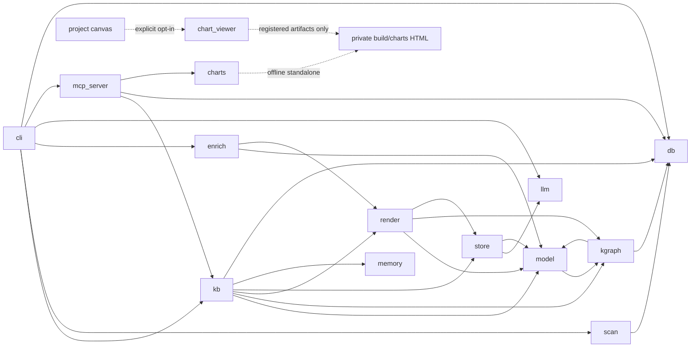
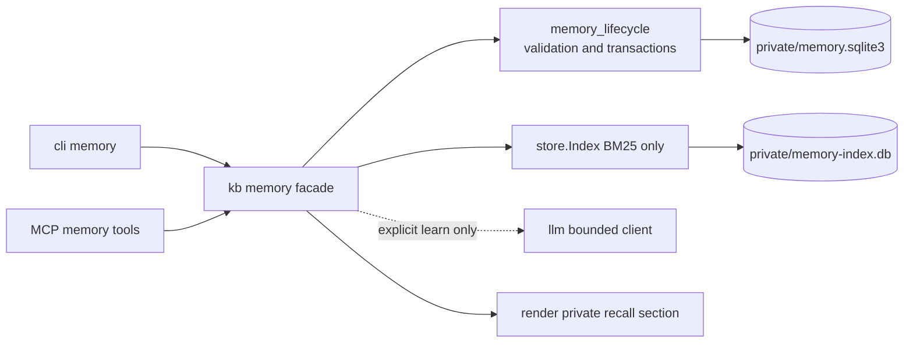

# Components

One section per module in `sqlmem/`. "Depends on" lists sqlmem modules only (from the imports).

## Interfaces

### `cli.py`
Command line: `scan`, `build`, `draft`, `graph`, `llm`, `context`, `search`, `table`, `path`, `tables`, `remember`,
`forget`, `memories`, `query`, `validate`, `stats`, `mcp`. Parses arguments, resolves `--kb`/`--db` (defaults
`$SQLMEM_KB`, `$SQLMEM_DB`), prints results. No business logic. **Depends on** kb, scan, enrich, llm, db, mcp_server.

### `mcp_server.py`
`create_server(kb, engine, row_cap=200, query_timeout=30.0, save_budget=90.0)` builds an MCP server with the tools
`get_sql_context`, `search_knowledge`, `describe_table`, `list_tables`, `find_join_path`, `remember`, `forget`,
`list_memories`, `get_knowledge_graph`, `knowledge_graph_task`, `save_knowledge_graph` and `run_sql`. Every tool is
wrapped so that exceptions become a `ToolError` with the first line of the message (actionable, no stack trace).
`serve()` runs it over stdio. **Invariants**: `run_sql` goes through `run_select` (guard, row cap, rollback, time
limit); `save_knowledge_graph` verification is bounded by `save_budget`.

**Visualization ([ADR 0011](../design/adr/0011-bounded-offline-chart-visualization.md)):**
`create_chart(source, spec, enable_3d=False)` accepts either SQL with declared typed columns or supplied typed rows. SQL calls
`run_select` with existing row/time limits and explicit truncation; rows mode never queries and works without an
engine. It delegates to `charts`, returns private artifact metadata, sanitizes errors, and declares local file
writes (not read-only or idempotent). It does not launch a viewer or send chart data to LLM/retrieval.

### Project chart skill and canvas
Repository-local skill `.github/skills/sqlmem-chart/SKILL.md` orchestrates explicit visualization requests, reuses
retrieved rows, resolves mappings/classification and reports partial results. The project-scoped Copilot canvas
uses the Copilot canvas skill's project-local registration contract and only displays generated HTML through
the Node adapter in `.github/extensions/sqlmem-chart/viewer.mjs`.
Raw show/refresh/download envelopes are shape-checked local actions, not host API calls or an agent/code bridge.
No global skill installation. **Requirements:** REQ-CHART-08/09.

## Visualization

### `charts.py` — shared typed offline renderer
Owns typed normalization and family-specific mapping/option validation,
`build_chart_option`, `render_chart_html` and `write_chart`. Uses `assets/chart.html` and pinned
`assets/vendor/` ECharts/optional echarts-gl, licenses and SHA-256 manifest; package-data rules must include them.
No database, LLM, knowledge indexing or viewer dependency; no new Python dependency. Rejects executable/raw options,
unknown/sensitive data and limit violations; escapes embedded data, enforces CSP, and writes atomic, non-clobbering
private artifacts only under configured ignored `build/charts`. The same responsive interactive HTML runs from
`file://` or in canvas, with warnings, accessible table and optional WebGL fallback state.
**Requirements:** REQ-CHART-01..07; exact interfaces, chart matrix and caps in ADR 0011.

### Project canvas HTTP adapter
`extension.mjs` uses the Copilot canvas SDK; `viewer.mjs` is its testable Node HTTP adapter. Open input
`{path, outputRoot}` registers exactly one canonical generated chart in `build/charts`. Binds only `127.0.0.1:0`,
without credentials in its URL. GET/HEAD `/` and `/download` only; strict Host/routes/IDs/canonical containment,
no file proxy/CORS/listings or render/query/write endpoints. Serves the existing standalone HTML with its CSP,
not a second renderer or host bridge. Refresh/show/download actions return metadata only.
The MCP tool never starts it automatically; request size/time/connections and server lifetime are bounded.
**Requirements:** REQ-CHART-08.

## Facade

### Proposed agentic extension — ADR 0012

The following is an implementation contract, not implemented behavior. `kb.py` adds `submit_conversation`,
`memory_task`, `save_memory`, `learn_conversation`, `recall_memory`, `memory_history`, `restore_memory`,
`memory_feedback`, `compact_memory`; CLI `memory` has matching `submit/task/save/learn/recall/history/restore/
feedback/compact` subcommands and MCP exposes those nine method names as tools. Exact signatures, flags,
reports and limits are in [ADR 0012](../design/adr/0012-bounded-source-linked-agentic-memory.md).
Existing memory interfaces and JSONL behavior are unchanged. `context`/`get_sql_context` gain optional
`session_id`, CLI `context` gains `--session`; selected schema tables cannot be displaced by private memory.

New `memory_lifecycle.py:LifecycleStore` owns stdlib SQLite transactions, sanitized immutable source revisions,
item heads/revisions, source lineage, feedback and archive events. It owns pure bounded validation/sanitization
helpers; it does not depend on database engines, optional LLM SDKs or the semantic model. The facade validates
table references, orchestrates explicit learning and updates an independent BM25-only private `Index`.
`render.py` only formats a bounded labelled untrusted/inferred section after existing schema/table selection.
`store.py:Index` is reused for this private derived projection; no shared schema-hit budget or vector candidate
pool. `llm.py` needs only narrow retry/deadline options for explicit memory generation with injected clients.
Private content is excluded from generated public docs/graph and legacy `index.db`.

### `kb.py` — `KnowledgeBase`
One folder = one knowledge base. Loads and saves `catalog.json`, `semantic.yaml`, `knowledge_graph.yaml`,
`memories.jsonl`, `sqlmem.json`; caches the `SemanticModel` (reloaded when a source file changes); owns the search
`Index` (`close()` releases it). Operations: `build`, `search`, `context`, `describe`, `join_path`, `list_tables`,
`remember`/`forget`, `kg_tasks`/`kg_prompt`/`import_kg`/`generate_kg`/`check_kg`, `validate_examples`.
**Depends on** model, kgraph, render, store, memory, db.

## Knowledge

### `scan.py` — facts
`scan_database(engine, ScanOptions)` reflects tables, views, materialized views, columns, keys, indexes, comments and
routines, then profiles data (row counts, null %, distinct counts, ranges, value dictionaries) with bounded sampling
and parallel workers. Falls back to `INFORMATION_SCHEMA` when a dialect's reflection is missing or broken.
`is_sensitive()` flags personal columns; their values are never stored. **Depends on** db.

### `model.py` — semantic model
`SemanticModel(catalog, semantic)` merges facts with the curated overlay: `Table`, `Column`, `Relationship`
(declared, curated, inferred, conditional). Infers undeclared joins from key naming, hides housekeeping columns,
resolves fuzzy table names, builds the value index (`match_values`), finds join paths (`join_path`) and connects a
set of tables with bridge tables (`connect`, a greedy Steiner tree). Also holds the loaded knowledge graph.
**Depends on** kgraph (graph normalization).

### `kgraph.py` — knowledge graph
Splits large schemas into prompt parts (`build_tasks`, `task_prompt`), normalizes LLM output (`normalize`), plans
each relation's join (`plan_relation`: declared keys, `via`, explicit `on`, polymorphic expansion, fan-out
rejection), and verifies entities and relations against the data (`validate_graph` with `_Checker`: per-query time
limit and overall budget; items that run out of time are kept unverified). `merge_graphs` and `to_yaml_dict` persist
the result. **Depends on** db, model.

### `enrich.py` — semantic drafts
`draft_semantic` writes a complete `semantic.yaml` skeleton (keeps curated text, reuses database comments);
`suggest_with_llm` fills gaps per table in parallel. **Depends on** model, render.

### `memory.py` — memories
`MemoryStore`: append-only JSON Lines of facts, rules, preferences, corrections and verified question → SQL pairs,
with validation and `forget`. No dependencies.

## Retrieval

### `render.py` — documents, chunks and context
Markdown knowledge cards and ER/graph diagrams (`table_doc`, `overview_doc`, `kg_doc`, `kg_html` from
`assets/knowledge-graph.html`), `graph_json`, search chunks (`build_chunks`, `kg_chunks`, `memory_chunk`), table
ranking (`rank_tables`, `select_tables`) and the prompt-ready context pack (`render_context`). **Depends on** model,
kgraph, store.

### `store.py` — hybrid index
`Index` in one SQLite file: chunks, an FTS5 table (Porter stemming, identifier splitting via `fts_query`) and
vectors cached by content hash. `search` fuses BM25 and cosine similarity with Reciprocal Rank Fusion. Embedders:
`HashEmbedder` (deterministic, tests), `FastEmbedEmbedder` (local), `OpenAIEmbedder` (Azure OpenAI, OpenAI,
Ollama). **Depends on** llm (clients), model (`split_identifier`).

## Infrastructure

### `db.py` — engines, guard and time limits
`resolve_url` (SQLite files open `mode=ro`), `make_engine` (read-only sessions on PostgreSQL, MySQL/MariaDB and
DuckDB; driver timeouts), `check_readonly` (single comment-free `SELECT`/`WITH`, no write or side-effect keywords,
dialect-specific quoting tricks rejected), `time_limit` (PostgreSQL `statement_timeout`, MySQL
`max_execution_time`, MariaDB `max_statement_time`, SQL Server driver timeout, SQLite/DuckDB `interrupt()`),
`run_select` (guard + time limit + row cap + rollback), `QueryTimeout`. No dependencies.

### `llm.py` — LLM access
Resolves which model to use (`--llm` > `$SQLMEM_LLM` > KB config), builds an OpenAI SDK client for Azure OpenAI
(Entra ID or key), OpenAI, Ollama or any OpenAI-compatible server, retries without parameters a model rejects, and
extracts JSON from replies (`LLM.complete_json`). No dependencies.
