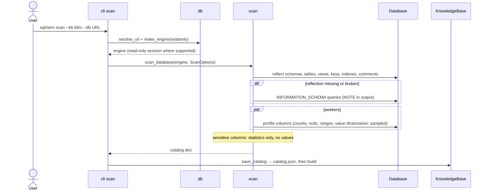
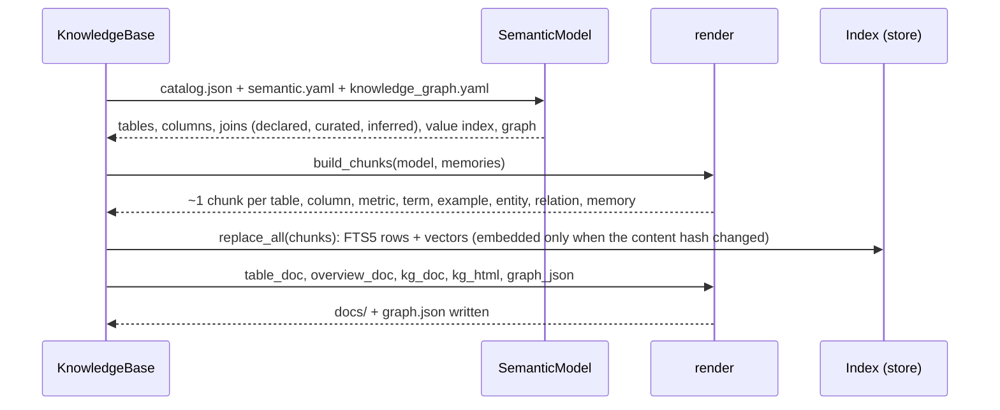
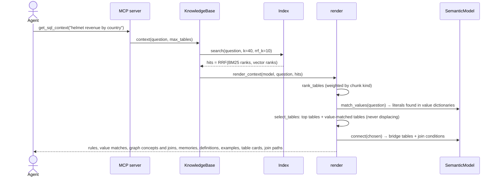
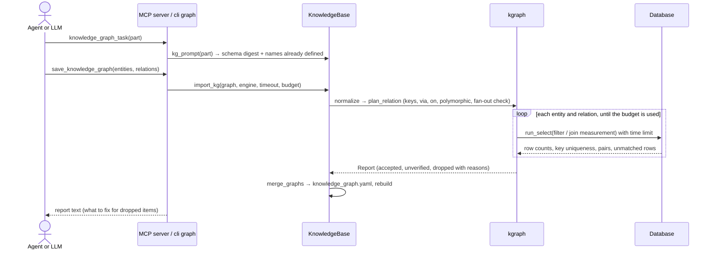
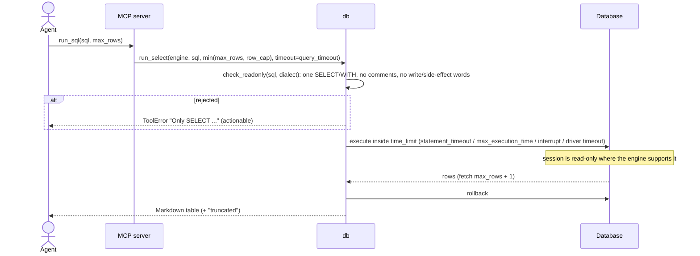
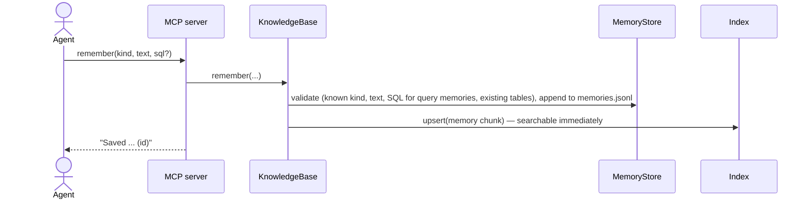
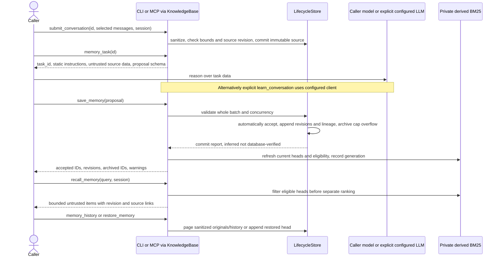

# Runtime flows

## 1. Scan: database → facts

## 2. Build: files → docs and index

## 3. Context pack for a question (`get_sql_context`)

## 4. Knowledge graph: propose → verify → save

## 5. `run_sql`: the safety boundary

## 6. Memory

This is the existing JSONL workflow; ADR 0012 leaves it intact.

## 7. Proposed agentic memory: submitted sources → automatic revisions → separate recall

[ADR 0012](../design/adr/0012-bounded-source-linked-agentic-memory.md) is the normative contract; this flow is
planned, not evidence of implementation. Every operation is synchronous and bounded; no chat monitoring/daemon.

Feedback adds idempotent outcome events; correction appends a sanitized source and replacement revision.
Explicit compact archives at most 100 working/episodic heads and records exact revision manifests, never deletes
originals. Automatic caps apply to all four types. History/include-archived recall and restore are explicit.
`context` runs flow 3's schema selection unchanged, then appends at most five private recalled items within
8 KiB. Private hits do not enter schema ranking, value/table/bridge budgets or verified-example sections.
