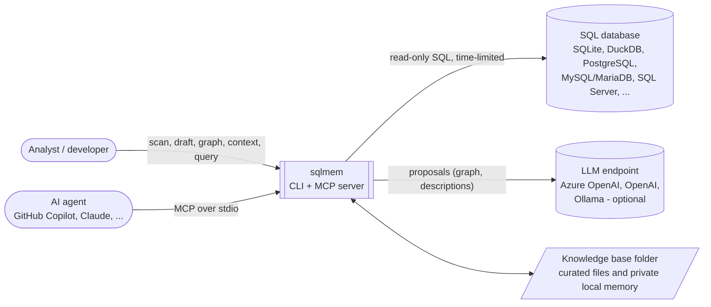
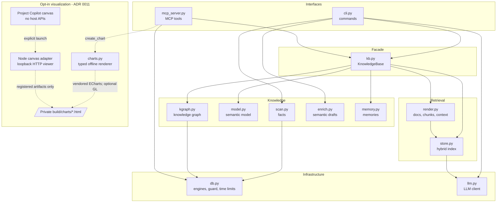
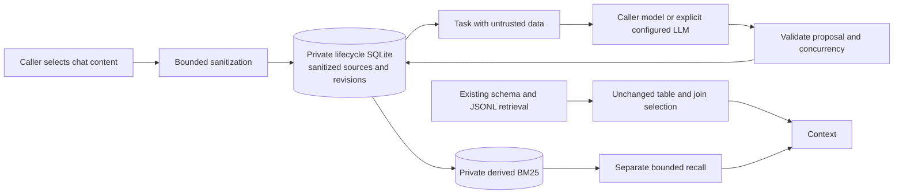

# Architecture overview

`sqlmem` gives AI agents a reliable understanding of a whole SQL database: what every table means, how tables join,
what codes stand for, which business concepts exist and how they relate, and which queries are known to be correct.
It learns from verified answers and corrections. The proposed
[agentic memory contract](../design/adr/0012-bounded-source-linked-agentic-memory.md) additionally accepts
caller-submitted conversations and inferred knowledge, explicitly distinct from database-verified facts.

## System context

| Actor | Interaction | Trust |
|---|---|---|
| User | CLI commands; curates `semantic.yaml` and the knowledge graph | trusted |
| AI agent | MCP tools: context, search, describe, join paths, memory, knowledge graph, `run_sql` | **untrusted input**: every SQL is guarded |
| LLM | proposes knowledge-graph items, descriptions and opt-in learned memory | **untrusted output**: graph uses data checks; learned memory stays labelled inferred |
| Database | source of facts | accessed read-only with time limits |

## Building blocks

Details per module: [components.md](components.md). Runtime behavior: [flows.md](flows.md). Files and schemas:
[data-model.md](data-model.md).

## Layers of knowledge

| Layer | File | Produced by | Trust |
|---|---|---|---|
| Facts | `catalog.json` | `scan` (automatic, read-only) | true by construction |
| Knowledge | `semantic.yaml` | humans, `draft --llm`, Copilot | curated, reviewed in git |
| Knowledge graph | `knowledge_graph.yaml` | LLM or Copilot proposes, `kgraph` verifies | verified against data |
| Memory | `memories.jsonl` | `remember` (CLI/MCP) | validated (kind, text, SQL present for queries, known tables) |
| Agentic sources/history (proposed) | `private/memory.sqlite3` | explicit submit, automatic proposal acceptance, feedback | sanitized, untrusted, inferred; immutable sources/revisions, not database verification |
| Agentic recall (proposed) | `private/memory-index.db` | projection of current lifecycle heads, archive eligibility explicit | disposable local BM25; separate from schema retrieval, never authority |
| Derived | `docs/`, `graph.json`, `index.db` | `build` | regenerable, `index.db` not committed |

## Quality attributes

| Attribute | How the architecture achieves it | Proven by |
|---|---|---|
| **Safety** (never modify data) | two layers: SQL guard + read-only sessions; every query rolled back | REQ-SAFE-01/02, cross-engine tests |
| **Bounded latency** | per-query time limits on every engine; MCP time budgets | REQ-SAFE-03, REQ-KG-08 |
| **Privacy** | sensitive columns profiled without values; local embeddings by default | REQ-SCAN-02 |
| **Portability** | SQLAlchemy only, `INFORMATION_SCHEMA` fallback, dialect-aware quoting | REQ-SCAN-04, 5 engines in CI |
| **Retrieval quality** | hybrid BM25 + vectors, value linking, knowledge graph, join planning | REQ-RET-05 eval gates |
| **Correct knowledge** | graph proposals undergo data checks; private inferred memory never gains verified status | REQ-KG-01..08; planned REQ-AMEM-04 |
| **Reviewability** | knowledge as plain files in git; derived files regenerable | ADR 0003 |
| **Evolvability** | typed code (mypy strict, pyright), requirement traceability, evidence per change | ADR 0010 |
| **Visualization boundary** | typed chart mappings, ignored private offline artifacts, guarded SQL reuse, bounded optional loopback viewer; no retrieval/index ingestion | REQ-CHART-01..09; verification plan in ADR 0011 |
| **Recoverable learning (proposed)** | bounded synchronous extraction, private originals/lineage, optimistic revisions and archive-only compaction; independent recall lane | REQ-AMEM-01..09; planned negative/stub/saturation tests in ADR 0012 |

## Proposed private memory boundary (ADR 0012)

No chat observation, daemon, automatic SQL/workflow execution or implicit model request. Automatic acceptance
means structurally valid inferred proposals become heads without approval, not that they are true. Archives
remove active context, not originals. See the ADR for exact methods/tools/commands, privacy limitations and caps.

## Technology

Python ≥ 3.11 · SQLAlchemy 2 · SQLite FTS5 (BM25) · NumPy (vector search) · fastembed `BAAI/bge-small-en-v1.5`
(local embeddings, optional) · OpenAI SDK v1 (Azure OpenAI with Entra ID, OpenAI, Ollama; optional) · MCP Python SDK
(optional) · PyYAML.

## Deployment

`sqlmem` is a local Python package. The MCP server runs as a stdio subprocess of the agent host (VS Code), one per
knowledge base and database, configured in `.vscode/mcp.json`. No service, no network listener; the only outbound
connections are to the database and, when configured, the LLM or embedding endpoint.

**Opt-in exception ([ADR 0011](../design/adr/0011-bounded-offline-chart-visualization.md)):**
an explicit visualization request can create a standalone HTML artifact in ignored `build/charts`, usable without
a server. Only explicit canvas launch starts a finite-lived `127.0.0.1` ephemeral HTTP viewer of registered
artifacts; ordinary CLI/MCP use stays stdio-only. The shared renderer embeds pinned ECharts and optional
echarts-gl with licenses; it sends no chart data externally and adds no Python dependency.

## Decisions

See the [ADR index](../design/README.md).
