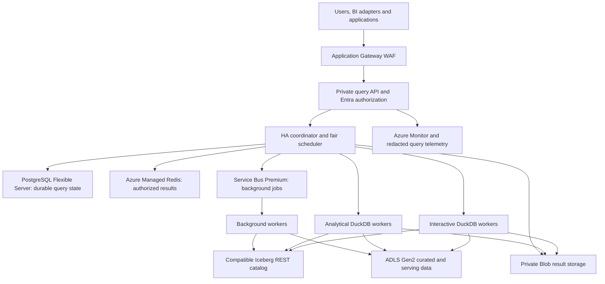
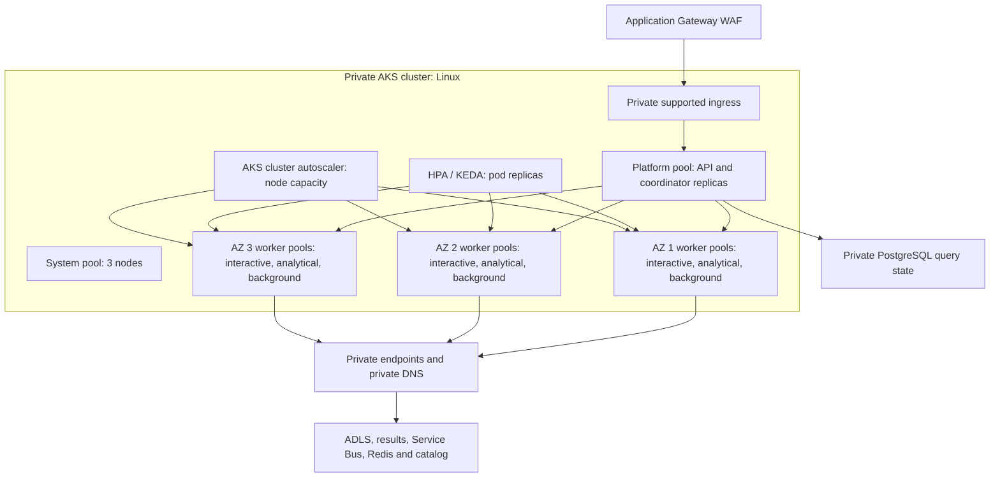
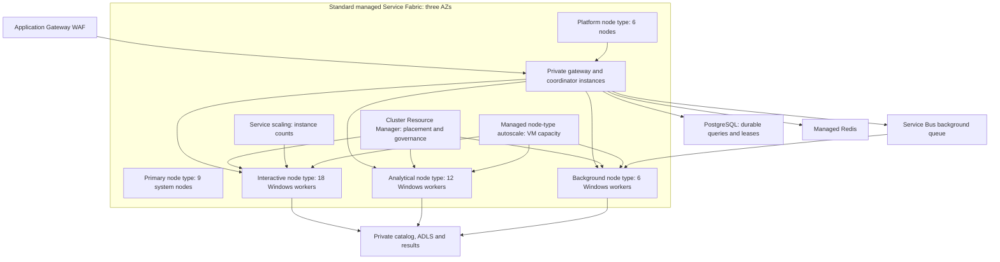
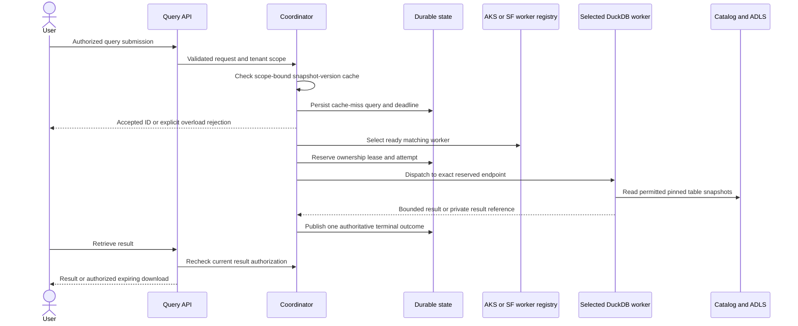
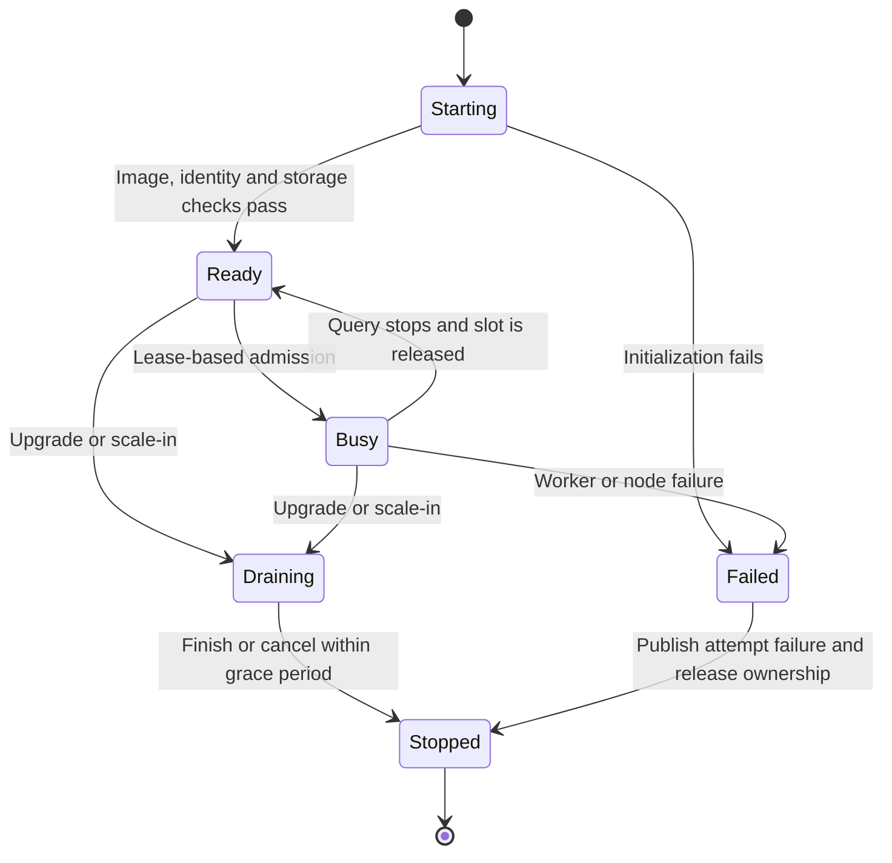

# DuckDB on Azure: AKS and Service Fabric deployment designs

| | |
|---|---|
| Status | Proposed reference architectures; not deployed or benchmarked |
| Date | 2026-11-03 |
| Scope | 100 TB analytical lake, 1,000 connected users, mixed interactive and ad hoc workloads |
| Option A | Azure Kubernetes Service (AKS), Linux containers |
| Option B | Azure Service Fabric managed cluster, Windows containers |

This is the Azure companion to the [AWS architecture](duckdb-scalable-analytics-architecture.md).
The two options are **alternative hosting choices**, not two clusters required for one platform.
Neither is an implemented `sqlmem` feature. Manifests and commands are illustrative deployment guidance,
not a validated infrastructure package. No cloud resources are created by this documentation update.

Both retain independent DuckDB execution workers, centralized admission control, private durable storage,
authorized versioned caching and separate workload pools. One SQL query runs on one worker; neither AKS
nor Service Fabric automatically turns DuckDB into a distributed single-query engine.

## Contents

1. [Shared Azure architecture](#1-shared-azure-architecture)
2. [Sizing and placement](#2-sizing-and-placement)
3. [AKS architecture](#3-aks-architecture)
4. [AKS deployment](#4-aks-deployment)
5. [Service Fabric architecture](#5-service-fabric-architecture)
6. [Service Fabric deployment](#6-service-fabric-deployment)
7. [Query execution and scaling](#7-query-execution-and-scaling)
8. [Security, reliability and operations](#8-security-reliability-and-operations)
9. [Choosing the hosting platform](#9-choosing-the-hosting-platform)
10. [Rollout and acceptance](#10-rollout-and-acceptance)
11. [References](#11-references)

## 1. Shared Azure architecture



| Concern | Azure component | Design responsibility |
|---|---|---|
| Ingress | Application Gateway WAF | Regional HTTPS ingress; private backend routes |
| Optional global ingress | Azure Front Door | Add only for a demonstrated global routing requirement |
| Authentication | Microsoft Entra ID | User identity; application still enforces data authorization |
| Images | Azure Container Registry (ACR) | Separate pinned Linux and Windows worker images |
| Data lake | Storage account with ADLS Gen2 | Private Parquet/Iceberg data and retained snapshots |
| Result objects | Private Blob container/account | Expiring large results with independent access policy |
| Catalog | Compatible Iceberg REST service | Snapshot resolution, authorization and coordinated commits |
| Application state | Azure Database for PostgreSQL Flexible Server | Queries, attempts, ownership leases and tenant quotas |
| Result cache | Azure Managed Redis | Small results and private result references |
| Background jobs | Azure Service Bus Premium | Bounded dispatch, lock renewal and dead-letter handling |
| Secrets | Azure Key Vault | Bootstrap credentials/certificates where identity cannot replace them |
| Networking | VNet, NSGs, private endpoints, private DNS and controlled egress | Protect worker/data/control planes |
| Observability | Azure Monitor, Log Analytics and platform-compatible exporters | Latency, capacity, failures and spend |

Provision private endpoints and DNS appropriate to the selected service SKUs. ADLS access can need both
`blob` and `dfs` endpoints; validate the actual extension/catalog request paths. PostgreSQL networking must
match its chosen supported private-access mode; do not combine incompatible delegated-subnet and endpoint
assumptions.

PostgreSQL is not automatically an Iceberg REST catalog. Select a catalog implementation with tested Azure
storage, identity and table-feature support. An externally operated catalog may need additional compute;
it is not included in the worker counts below.

Use DuckDB's [Azure extension](https://duckdb.org/docs/stable/core_extensions/azure) for supported Blob/ADLS
access. Pin the extension and engine; test their authentication provider on the selected host OS.
AKS federated identity and Service Fabric application identity are different token flows, not interchangeable
environment variables. A trusted worker bootstrap may need an SDK/token integration; do not claim that a
managed identity is automatically consumed by every DuckDB/catalog client.

Preserve the AWS design's [security boundary](duckdb-scalable-analytics-architecture.md#9-security-boundaries),
[cache rules](duckdb-scalable-analytics-architecture.md#7-data-lake-and-caching) and
[service objectives](duckdb-scalable-analytics-architecture.md#1-goals-and-boundaries).
Those latency targets remain unmeasured, including on Azure.

## 2. Sizing and placement

### Worker-only planning baselines

These are starting configurations for benchmarking, not guarantees for 1,000 active queries.
Azure background workers use 32 GiB machines, unlike the 16 GiB background machines in the AWS proposal.

| Host | Pool | Worker VMs/instances | Reference VM | vCPU/VM | GiB/VM | Total vCPU | Total GiB |
|---|---|---:|---|---:|---:|---:|---:|
| AKS | Interactive | 18 | `Standard_E8ds_v5` | 8 | 64 | 144 | 1,152 |
| AKS | Analytical | 10 | `Standard_E8ds_v5` | 8 | 64 | 80 | 640 |
| AKS | Background | 4 | `Standard_D8ds_v5` | 8 | 32 | 32 | 128 |
| **AKS workers** | | **32** | | | | **256** | **1,920** |
| Service Fabric | Interactive | 18 | `Standard_E8ds_v5` | 8 | 64 | 144 | 1,152 |
| Service Fabric | Analytical | 12 | `Standard_E8ds_v5` | 8 | 64 | 96 | 768 |
| Service Fabric | Background | 6 | `Standard_D8ds_v5` | 8 | 32 | 48 | 192 |
| **Service Fabric workers** | | **36** | | | | **288** | **2,112** |

Service Fabric uses 12 analytical and six background nodes to fit the reference zone-spanning topology.
The managed-cluster guidance recommends nine primary nodes and at least six nodes per secondary node type
for best resiliency; these are different constraints from AKS pod placement.

| Additional hosting capacity | Reference count and size | Purpose |
|---|---|---|
| AKS system pool | 3 x `Standard_D4s_v5` | Kubernetes-critical workloads |
| AKS platform pool | 3 x `Standard_D4s_v5` | API/coordinator replicas; validate headroom |
| Service Fabric primary node type | 9 x `Standard_D4s_v5` | Cluster system services, three per AZ |
| Service Fabric platform node type | 6 x `Standard_D4s_v5` | Gateway/coordinator, two per AZ |

With these explicit non-worker assumptions, AKS has **38 VMs, 280 vCPU and 2,016 GiB**, while Service Fabric
has **51 VMs, 348 vCPU and 2,352 GiB**. This excludes the managed databases/cache, catalog compute and any
extra upgrade/AZ-loss headroom. Validate platform-service resource budgets separately.

### Process and scratch budgets

| Setting | AKS interactive | AKS analytical | SF interactive/analytical |
|---|---|---|---|
| DuckDB threads | 6 | 6-8 after profiling | 6 |
| DuckDB memory limit | 42 GB | 48 GB | 42 GB |
| Worker memory request | 52 GiB | 54 GiB proposed | 49,152 MB in manifest |
| Worker memory limit | 54 GiB | 56 GiB proposed | 49,152 MB in manifest |
| DuckDB scratch cap | 150 GB | 300 GB | 150 GB initially |
| Initial active queries/worker | 1 | 1 | 1 |

Service Fabric's default auto-detected resource capacity leaves a 20% buffer. On an eight-core, 64 GiB node,
that is **6.4 cores and 51.2 GiB** for placement. The SF example therefore requests six cores and 49,152 MB
(48 GiB), rather than copying AKS's seven-core/52-GiB request, which would not fit that default.
Confirm runtime memory units and actual reported node capacity before registration.

Background budgets are separate: start with four DuckDB threads and 18 GB memory on AKS; on Service Fabric,
use four governed cores, 20,480 MB worker memory and a 16 GB DuckDB limit. Heavy background joins may need
memory-optimized nodes instead.

`Standard_E8ds_v5` has 300 GiB of local temporary storage. That is **not** 300 GiB of safely available
DuckDB spill space after OS/runtime use, and it is not durable. The AKS example uses provisioned managed
OS-disk-backed ephemeral storage; the SF example explicitly mounts a prepared temporary host directory.
Change VM family or storage mapping only after profiling and recalculating the disk budget.

For larger SF analytical spill needs, provision a separate appropriately sized disk or larger VM; do not set
a 300 GB DuckDB cap on a shared 300 GiB temporary disk without overhead allowances.

## 3. AKS architecture



Choose a currently supported ingress integration and pin its controller/chart/API versions. Application
Gateway routing is not provided merely by creating the AKS cluster or a worker `ClusterIP` Service.

Use one worker pool per workload **and per zone** for predictable autoscaler balancing. Suggested initial
counts across zones 1/2/3 are interactive 6/6/6, analytical 3/3/4 and background 1/1/2.
The [AKS autoscaler guidance](https://learn.microsoft.com/en-us/azure/aks/cluster-autoscaler-overview)
recommends per-zone pools with balanced similar groups for zone-aware workloads.

- HPA changes Deployment replica counts; KEDA can own the background deployment.
- The AKS cluster autoscaler provisions node-pool capacity for pending pods; it does not schedule SQL.
- The query coordinator owns tenant fairness, slots, deadlines and queue admission.
- Use Entra Workload ID with annotated service accounts and federated credentials.
- Isolate security domains with scoped identities and restricted dispatch; workload pools alone do not
  constitute tenant isolation.

## 4. AKS deployment

### Infrastructure prerequisites

Before running any provisioning command, approve region, quota and cost. Prepare a VNet, private API/DNS
access, routable ingress subnet, AKS subnet, private service connectivity, managed identities, ACR, logging
and the shared data services. The following PowerShell snippets are **examples to adapt**, not commands
executed for this documentation.

Example cluster creation after the referenced network/identity resources exist:

```powershell
$ResourceGroup = "YOUR_RESOURCE_GROUP"
$Location = "YOUR_ZONE_SUPPORTED_REGION"
$AksName = "duckdb-aks"
$AksSubnetId = "YOUR_AKS_SUBNET_RESOURCE_ID"
$AksIdentityId = "YOUR_USER_ASSIGNED_IDENTITY_RESOURCE_ID"

az aks create --resource-group $ResourceGroup --name $AksName --location $Location `
  --tier standard --enable-private-cluster --enable-aad --enable-azure-rbac `
  --disable-local-accounts --enable-oidc-issuer --enable-workload-identity `
  --assign-identity $AksIdentityId --network-plugin azure --network-plugin-mode overlay `
  --vnet-subnet-id $AksSubnetId --outbound-type userDefinedRouting `
  --nodepool-name system --node-count 3 --node-vm-size Standard_D4s_v5 --zones 1 2 3
if ($LASTEXITCODE -ne 0) { throw "AKS cluster creation failed" }
```

`userDefinedRouting` requires preconfigured, working outbound routing/firewall access. Assign the cluster
identity its required subnet/network permissions first. Private API access requires a connected operator/CI
runner. Configure the supported OS/Kubernetes versions, upgrade policy, private DNS and address ranges in
the final IaC; they are not fully specified here.

Create the platform user pool separately, then create the nine worker pools:

```powershell
az aks nodepool add --resource-group $ResourceGroup --cluster-name $AksName `
  --name platform --mode User --node-count 3 --node-vm-size Standard_D4s_v5 `
  --zones 1 2 3 --labels workload=platform
if ($LASTEXITCODE -ne 0) { throw "Platform pool creation failed" }

$Pools = @(
  @{ Name="intz1"; Zone="1"; Count=6; Max=12; Workload="interactive"; Size="Standard_E8ds_v5" },
  @{ Name="intz2"; Zone="2"; Count=6; Max=12; Workload="interactive"; Size="Standard_E8ds_v5" },
  @{ Name="intz3"; Zone="3"; Count=6; Max=12; Workload="interactive"; Size="Standard_E8ds_v5" },
  @{ Name="anaz1"; Zone="1"; Count=3; Max=8; Workload="analytical"; Size="Standard_E8ds_v5" },
  @{ Name="anaz2"; Zone="2"; Count=3; Max=8; Workload="analytical"; Size="Standard_E8ds_v5" },
  @{ Name="anaz3"; Zone="3"; Count=4; Max=8; Workload="analytical"; Size="Standard_E8ds_v5" },
  @{ Name="bgz1"; Zone="1"; Count=1; Max=4; Workload="background"; Size="Standard_D8ds_v5" },
  @{ Name="bgz2"; Zone="2"; Count=1; Max=4; Workload="background"; Size="Standard_D8ds_v5" },
  @{ Name="bgz3"; Zone="3"; Count=2; Max=4; Workload="background"; Size="Standard_D8ds_v5" }
)
foreach ($Pool in $Pools) {
  $Label = "workload=duckdb-$($Pool.Workload)"
  az aks nodepool add --resource-group $ResourceGroup --cluster-name $AksName `
    --name $Pool.Name --mode User --zones $Pool.Zone --node-count $Pool.Count `
    --node-vm-size $Pool.Size --node-osdisk-type Managed --node-osdisk-size 512 `
    --enable-cluster-autoscaler --min-count $Pool.Count --max-count $Pool.Max `
    --labels $Label --node-taints workload=duckdb:NoSchedule
  if ($LASTEXITCODE -ne 0) { throw "Worker pool creation failed: $($Pool.Name)" }
}
```

The 512 GiB OS-disk assumption supports the illustrative disk-backed spill allocations with overhead;
validate actual node allocatable storage, root filesystem layout, throughput and billing. This does not mount
the VM's local temporary SSD. Provision explicit local volumes if that is the intended optimization.

### Interactive Kubernetes example

Before applying, replace the ACR image/client-ID placeholders, create the federated credential for this
service account, grant least-privilege storage access, and configure image-pull authorization on the AKS
kubelet identity. Pull authorization and pod-to-storage identity are different permissions.

```yaml
apiVersion: v1
kind: Namespace
metadata:
  name: analytics
---
apiVersion: v1
kind: ServiceAccount
metadata:
  name: duckdb-interactive
  namespace: analytics
  annotations:
    azure.workload.identity/client-id: "YOUR_WORKER_IDENTITY_CLIENT_ID"
---
apiVersion: apps/v1
kind: Deployment
metadata:
  name: duckdb-interactive
  namespace: analytics
spec:
  replicas: 18
  selector:
    matchLabels:
      app: duckdb-interactive
  template:
    metadata:
      labels:
        app: duckdb-interactive
        azure.workload.identity/use: "true"
    spec:
      serviceAccountName: duckdb-interactive
      terminationGracePeriodSeconds: 180
      nodeSelector:
        workload: duckdb-interactive
        kubernetes.io/os: linux
      tolerations:
        - key: workload
          operator: Equal
          value: duckdb
          effect: NoSchedule
      topologySpreadConstraints:
        - maxSkew: 1
          topologyKey: topology.kubernetes.io/zone
          whenUnsatisfiable: ScheduleAnyway
          labelSelector:
            matchLabels:
              app: duckdb-interactive
      containers:
        - name: worker
          image: YOUR_ACR.azurecr.io/duckdb-worker-linux:PINNED_VERSION
          ports:
            - name: http
              containerPort: 8080
          env:
            - name: DUCKDB_THREADS
              value: "6"
            - name: DUCKDB_MEMORY_LIMIT
              value: "42GB"
            - name: DUCKDB_TEMP_DIRECTORY
              value: "/mnt/duckdb-tmp"
            - name: DUCKDB_MAX_TEMP_DIRECTORY_SIZE
              value: "150GB"
          resources:
            requests:
              cpu: "7"
              memory: "52Gi"
              ephemeral-storage: "180Gi"
            limits:
              cpu: "8"
              memory: "54Gi"
              ephemeral-storage: "200Gi"
          volumeMounts:
            - name: scratch
              mountPath: /mnt/duckdb-tmp
          readinessProbe:
            httpGet:
              path: /ready
              port: http
            periodSeconds: 5
          livenessProbe:
            httpGet:
              path: /health
              port: http
            initialDelaySeconds: 30
            periodSeconds: 15
      volumes:
        - name: scratch
          emptyDir:
            sizeLimit: 180Gi
---
apiVersion: v1
kind: Service
metadata:
  name: duckdb-interactive
  namespace: analytics
spec:
  type: ClusterIP
  selector:
    app: duckdb-interactive
  ports:
    - name: http
      port: 8080
      targetPort: http
---
apiVersion: autoscaling/v2
kind: HorizontalPodAutoscaler
metadata:
  name: duckdb-interactive
  namespace: analytics
spec:
  scaleTargetRef:
    apiVersion: apps/v1
    kind: Deployment
    name: duckdb-interactive
  minReplicas: 18
  maxReplicas: 36
  metrics:
    - type: Resource
      resource:
        name: cpu
        target:
          type: Utilization
          averageUtilization: 70
  behavior:
    scaleDown:
      stabilizationWindowSeconds: 300
```

The worker application must implement readiness/liveness, graceful SIGTERM and `DUCKDB_*` configuration;
this is not supplied by a bare DuckDB image. The internal Service is for discovery/convenience, not blind
load balancing of admitted execution. Register individual ready worker endpoints and dispatch to the worker
whose slot the coordinator reserved; otherwise a Service can route to a different, overloaded pod.

Add tested NetworkPolicies, pod security settings, startup probes, disruption budgets and custom queue-age/
slot-demand metrics. KEDA should be the only replica-scaling owner for background Deployments. Do not run a
second independent HPA on a KEDA-owned Deployment.

From a connected, authorized operator machine, after saving adapted manifests:

```powershell
az aks get-credentials --resource-group $ResourceGroup --name $AksName
if ($LASTEXITCODE -ne 0) { throw "Getting AKS credentials failed" }
kubectl apply --dry-run=server -f .\deploy\aks\interactive.yaml
if ($LASTEXITCODE -ne 0) { throw "Kubernetes server-side validation failed" }
kubectl apply -f .\deploy\aks\interactive.yaml
if ($LASTEXITCODE -ne 0) { throw "Kubernetes deployment failed" }
kubectl rollout status deployment duckdb-interactive --namespace analytics
if ($LASTEXITCODE -ne 0) { throw "Worker rollout failed" }
```

The local example filename is a proposed deployment artifact, not a file shipped by this repository.
The operator needs the approved Azure RBAC roles and compatible Azure CLI, `kubectl` and Entra login tooling.

## 5. Service Fabric architecture

The concrete reference below is a **Standard SKU managed cluster with Windows node images and Windows
worker containers**. Choose a supported runtime/node-image combination and compatible container base image.
A Linux AKS image cannot run unchanged on Windows nodes.

If Linux container reuse is mandatory, evaluate a separately provisioned Linux Service Fabric cluster and
its currently supported runtime/OS/features. Do not assume this managed Windows deployment becomes Linux
by changing the image name.



- Reserve the primary node type for Service Fabric system services.
- Deploy the gateway/coordinator on a separate platform node type.
- Deploy workers as **stateless services** with one worker process/container per instance.
- Do not model DuckDB files as stateful Reliable Collections replicas. Durable data stays in ADLS and
  application state stays in PostgreSQL for both hosting options.
- Use node-type placement constraints, resource governance and exclusive service-package activation.
- Register each healthy worker's reachable endpoint and use the same lease-based dispatch protocol as AKS.
- Use fault/upgrade-domain placement and monitored rolling application upgrades.

For managed clusters, configure zone resiliency from creation, nine primary nodes and zone-spanning secondary
types. Use supported managed-cluster/node-type resources and operations; do not directly mutate their
provider-managed scale sets, disks or load balancers.

## 6. Service Fabric deployment

### Cluster and node types

Provision through reviewed Bicep/ARM or supported Az commands. This document specifies the desired topology,
not a complete cluster template:

| Node type | Primary? | Reference nodes | Placement property/purpose |
|---|---|---:|---|
| `primary` | Yes | 9 | System only |
| `platform` | No | 6 | Gateway/coordinator |
| `interactive` | No | 18 | `NodeType == interactive` |
| `analytical` | No | 12 | `NodeType == analytical` |
| `background` | No | 6 | `NodeType == background` |

Select Standard SKU, supported three-zone resiliency, private management access, cluster/client certificate
policy, supported Windows images/container runtime, ingress, private endpoints, OS/data disks, monitoring and
node-type resource capacities. Prepare `D:\duckdb-tmp` on applicable worker hosts and verify its disk mapping,
ACLs, available space and cleanup. Host paths below are examples, not a guarantee that every image uses `D:`
for temporary storage.

Example supported operation to add an interactive secondary node type to an already provisioned cluster:

```powershell
New-AzServiceFabricManagedNodeType `
  -ResourceGroupName "YOUR_RESOURCE_GROUP" `
  -ClusterName "YOUR_MANAGED_CLUSTER" `
  -Name "interactive" `
  -InstanceCount 18 `
  -VmSize "Standard_E8ds_v5" `
  -ErrorAction Stop
```

Configure and verify its supported Windows image, zone behavior, disk/runtime bootstrap, capacity and
networking before registering the application. The command alone is not the complete node-type definition.
Managed node-type configuration is distinct from the application service instance count.

### Interactive application package

Proposed package layout:

```text
DuckDbApplication\
    ApplicationManifest.xml
    DuckDbInteractivePkg\
        ServiceManifest.xml
        Code\
```

The `Code` directory belongs to the declared code package; the Windows container image contains the worker.
Use a real pinned ACR image and configure approved registry pull authentication separately. Never put an ACR
admin password in the manifests.

Example `ServiceManifest.xml`:

```xml
<?xml version="1.0" encoding="utf-8"?>
<ServiceManifest Name="DuckDbInteractivePkg" Version="1.0.0"
                 xmlns="http://schemas.microsoft.com/2011/01/fabric">
  <ServiceTypes>
    <StatelessServiceType ServiceTypeName="DuckDbInteractiveType" UseImplicitHost="true" />
  </ServiceTypes>
  <CodePackage Name="Code" Version="1.0.0">
    <EntryPoint>
      <ContainerHost>
        <ImageName>YOUR_ACR.azurecr.io/duckdb-worker-windows:PINNED_VERSION</ImageName>
      </ContainerHost>
    </EntryPoint>
    <EnvironmentVariables>
      <EnvironmentVariable Name="DUCKDB_THREADS" Value="6" />
      <EnvironmentVariable Name="DUCKDB_MEMORY_LIMIT" Value="42GB" />
      <EnvironmentVariable Name="DUCKDB_TEMP_DIRECTORY" Value="C:\duckdb-tmp" />
      <EnvironmentVariable Name="DUCKDB_MAX_TEMP_DIRECTORY_SIZE" Value="150GB" />
    </EnvironmentVariables>
  </CodePackage>
  <Resources>
    <Endpoints>
      <Endpoint Name="WorkerEndpoint" Protocol="http" Type="Input" Port="8080" />
    </Endpoints>
  </Resources>
</ServiceManifest>
```

Example `ApplicationManifest.xml`:

```xml
<?xml version="1.0" encoding="utf-8"?>
<ApplicationManifest ApplicationTypeName="DuckDbAnalyticsType" ApplicationTypeVersion="1.0.0"
                     xmlns="http://schemas.microsoft.com/2011/01/fabric">
  <Parameters>
    <Parameter Name="InteractiveCount" DefaultValue="18" />
  </Parameters>
  <ServiceManifestImport>
    <ServiceManifestRef ServiceManifestName="DuckDbInteractivePkg" ServiceManifestVersion="1.0.0" />
    <Policies>
      <ServicePackageResourceGovernancePolicy CpuCores="6" />
      <ResourceGovernancePolicy CodePackageRef="Code" MemoryInMB="49152" />
      <ContainerHostPolicies CodePackageRef="Code">
        <PortBinding ContainerPort="8080" EndpointRef="WorkerEndpoint" />
        <Volume Source="D:\duckdb-tmp" Destination="C:\duckdb-tmp" IsReadOnly="false" />
      </ContainerHostPolicies>
    </Policies>
  </ServiceManifestImport>
  <DefaultServices>
    <Service Name="Interactive" ServicePackageActivationMode="ExclusiveProcess">
      <StatelessService ServiceTypeName="DuckDbInteractiveType" InstanceCount="[InteractiveCount]">
        <SingletonPartition />
        <PlacementConstraints>NodeType == interactive</PlacementConstraints>
      </StatelessService>
    </Service>
  </DefaultServices>
</ApplicationManifest>
```

Requests-only governance also sets the corresponding limits. With one code package, the six-core service
package budget applies to that worker; the memory request/limit is 49,152 MB. Confirm these requests fit the
node's capacity after Service Fabric's buffer and any other packages.

Keep one instance of this singleton stateless service per interactive node, do not enable multiple instances
of the same partition on one node, and validate port/placement behavior. The host-mounted directory is
scratch only; do not share it across worker instances or store authoritative DuckDB data there.

The fixed internal HTTP port is an illustrative dispatch endpoint, not production transport security.
Configure authenticated TLS/service-to-service access through the chosen worker/proxy integration before
launch. Restrict the host port with NSGs/firewall; never expose `/execute` through public ingress.

### Application registration and rollout

After building compatible Windows images, adapting the package and connecting to the cluster securely
using the Service Fabric SDK and approved client certificate:

```powershell
Test-ServiceFabricApplicationPackage -ApplicationPackagePath .\DuckDbApplication -ErrorAction Stop
Copy-ServiceFabricApplicationPackage -ApplicationPackagePath .\DuckDbApplication `
  -ApplicationPackagePathInImageStore DuckDbApplication -ErrorAction Stop
Register-ServiceFabricApplicationType -ApplicationPathInImageStore DuckDbApplication -ErrorAction Stop
New-ServiceFabricApplication -ApplicationName fabric:/DuckDbAnalytics `
  -ApplicationTypeName DuckDbAnalyticsType -ApplicationTypeVersion 1.0.0 -ErrorAction Stop
Get-ServiceFabricServiceHealth -ServiceName fabric:/DuckDbAnalytics/Interactive -ErrorAction Stop
```

These commands create a runtime application but do **not** assign a per-application managed identity.
Service Fabric application identities require deployment as Azure application resources and explicit
application-to-service identity mapping. If that is the chosen authentication path, provision the application
through the supported ARM/Bicep resource flow instead of treating `New-ServiceFabricApplication` as equivalent.
Do not assume node identity grants every container a safely isolated tenant identity.

The SDK/package validation commands were not executed here. Use them in the implementation environment.
Add separate analytical/background service packages with their own budgets, placement and identities,
and separate gateway/coordinator deployment. Perform monitored upgrades with health checks, drain behavior,
rollback and explicit spare capacity rather than replacing all instances at once.

## 7. Query execution and scaling



Only accepted, admitted requests continue through dispatch. Invalid SQL, authorization failures and full
queues produce explicit errors. Background jobs use a separately authorized write-capable interface.

| Hosting option | Initial active worker slots | Conditional ceiling |
|---|---:|---:|
| AKS: 18 interactive + 10 analytical + 4 background | 32 | 50 |
| SF: 18 interactive + 12 analytical + 6 background | 36 | 54 |

The conditional ceiling allows two lightweight interactive queries per worker **only after** combined
memory/CPU/latency tests. The process budgets are shared across connections, not multiplied per query.
Connected users, submitted/in-flight requests and executing SQL are separate metrics.

| Scaling layer | AKS | Service Fabric |
|---|---|---|
| Query slots | Coordinator admission policy | Same coordinator policy |
| Worker instances | HPA/custom metrics; KEDA for background | Stateless service instance scaling |
| Machines | AKS cluster autoscaler per node pool | Supported managed secondary-node-type autoscale |
| System/control capacity | Separate pool policy | Primary node type maintained through supported manual operations |
| Placement | Selectors, taints, resources, topology constraints | Node types, placement constraints, fault/upgrade domains and governance |

For AKS, proposed worker maxima are 36 interactive, 24 analytical and 12 background. SF can use the same
72-worker maximum, but its baseline is 36 rather than 32. Preserve pool/security-domain quotas when adding
capacity.

Service Fabric service scaling does not automatically add nodes; node autoscale does not automatically raise
service instance counts. A queue-age/custom load metric needs an appropriate Service Fabric reporting or
external controller integration; a generic Windows container does not magically report Service Fabric metrics.
Do not set `InstanceCount="-1"` when you need a bounded independent service-scaling policy.

Drain before service scale-in, pod deletion, node removal and rolling upgrades. Both platforms can force
termination; deadlines, stopped-execution confirmation and retry-safe durable leases are still necessary.

## 8. Security, reliability and operations

### Shared controls

- Restrict user SQL to a verified read-only interface with approved sources/functions and bound parameters.
  Read-only alone is not a sandbox against file/network readers or extension loading.
- Enforce tenant row/column/table scope before dispatch, cache lookup and result retrieval.
- Scope workers, identities, catalog access and result policies by security domain; never rely on prefixes
  or a shared broad node identity as tenant isolation.
- Bootstrap extensions/configuration through trusted code. Do not accept user `INSTALL`, `LOAD`, `ATTACH`,
  exports or configuration changes.
- Make storage, registry, queue, catalog and management access private where supported; configure DNS and
  controlled egress explicitly.
- Keep secrets and reusable storage credentials out of images, manifests, SQL logs and native DuckDB files.
- Track policy and table/serving versions in cache keys; invalidate on revocation/refresh.
- Apply bounded submissions, queue size, memory, spill, output, attempts and total query deadlines.
- For Service Bus, handle message-lock expiry/renewal, duplicate delivery and dead letters; do not claim
  exactly-once processing from the queue itself.

### Recovery boundaries



Replacement pods/SF instances start a new lifecycle. Failure reporting must not release a slot while the
original process is still executing; interrupt it or terminate its isolated host process first.

Back up query-state PostgreSQL and the catalog; define restore procedures, RPO/RTO and table snapshot/file
retention. Validate regional/AZ-loss behavior for the selected storage redundancy and service tiers.
Zone spreading does not preserve the full running-query capacity after an AZ failure.

Track per-class queue age and latency, active slots, retries, rejected requests, RSS, spill bytes/disk capacity,
storage request latency, catalog health, cache evictions, Service Bus locks/dead letters and spend.
On AKS add pending pods, autoscaler events and node drain/upgrade telemetry. On SF add service/package health,
unplaced instances, node-type capacity, fault/upgrade domains and monitored upgrade progress.

## 9. Choosing the hosting platform

| Decision factor | AKS | Service Fabric managed Windows |
|---|---|---|
| Existing Linux worker image | Direct target after validation | Requires Windows image or a different Linux SF deployment |
| Packaging | OCI image and Kubernetes manifests | Compatible image plus application/service XML |
| Team/platform fit | Kubernetes/container operating model | Existing Service Fabric fleet and expertise |
| Identity | Entra Workload ID per service account | Explicit Azure application resource/service identity mapping |
| Autoscaling integration | HPA/KEDA plus cluster autoscaler | Service instance metrics plus managed node-type scaling |
| System-node overhead | Separate managed-Kubernetes system pool | Dedicated primary node type; larger reference zone topology |
| Rolling upgrades | Deployment, probes, PDBs and node-upgrade controls | Monitored application upgrades and fault/upgrade-domain controls |
| Main implementation risk | Incorrect pod identity/dispatch/storage/scaling integration | Image/runtime compatibility, governance, identity and dual-layer scaling |

**Proposed recommendation:** use AKS for a new Linux/container-first deployment. Use Service Fabric when the
organization already operates it and can support compatible Windows workers and application packaging.
Both still require the same query-service engineering; neither is a shortcut around admission control or
catalog/security correctness.

### Azure cost model

Do not translate the AWS dollar estimate into an Azure quote. Price regional VM hours, Windows/container
runtime licensing where applicable, managed disks/IOPS, ADLS footprint and requests, private networking,
WAF ingress, PostgreSQL HA, Redis, Service Bus Premium, catalog hosting and monitoring independently.

```text
AKS reference VM cost =
    28 * E8ds_v5 hourly rate * runtime hours
  + 4 * D8ds_v5 hourly rate * runtime hours
  + 6 * D4s_v5 hourly rate * runtime hours

Service Fabric reference VM cost =
    30 * E8ds_v5 hourly rate * runtime hours
  + 6 * D8ds_v5 hourly rate * runtime hours
  + 15 * D4s_v5 hourly rate * runtime hours
```

Add actual disk, managed-service and control-plane/tier charges plus upgrade/AZ-loss capacity. Managed
Service Fabric's simplified cluster management does not make its underlying VMs/storage free.
Use the [Azure pricing calculator](https://azure.microsoft.com/pricing/calculator/) and record tested cost
per successful delivered query before buying commitments.

## 10. Rollout and acceptance

| Stage | Both options | AKS-specific exit evidence | SF-specific exit evidence |
|---|---|---|---|
| Foundation | Private lake/catalog/state/cache/queue and scoped identities | Connected private API, node pools and image pulls | Healthy Standard zone-spanning cluster and supported Windows runtime |
| Worker smoke test | Read an authorized pinned snapshot and stop a query | Workload-ID token flow, selected pod dispatch and scratch mapping | Package/OS validation, application identity and governed placement |
| Query platform | API, lease state, quotas, classification and cache | Probes, service discovery, graceful SIGTERM | Registered endpoints, health reporting and monitored upgrades |
| Performance | Representative cold/warm mixed workloads | Safe pod resources and HPA/KEDA/node scaling | Safe governance and service/node-type scaling |
| Production readiness | Recovery, runbooks, pricing and operational ownership | Pod/node/AZ failure and private DNS recovery | Instance/node-type/AZ failure and upgrade rollback |

Launch only after:

- [ ] Testing 1,000 connected users at a specified arrival rate and representative query mix.
- [ ] Testing 200 concurrent in-flight requests and 1,000 simultaneous submissions with bounded queueing.
- [ ] Proving per-class end-to-end latency, including rejected/queued requests and cold caches.
- [ ] Testing identity renewal, raw-path/function bypass, tenant isolation, cache revocation and result access.
- [ ] Verifying one-query resource limits and conditional two-query admission without memory overcommit.
- [ ] Testing cancellation, expired leases, late results, retries and Service Bus duplicate delivery.
- [ ] Testing storage/catalog/cache outages, scratch exhaustion, autoscaling and rolling upgrades.
- [ ] Testing AZ loss, documented degraded capacity and database/catalog restore.
- [ ] Validating manifests with the actual Kubernetes API or Service Fabric SDK/runtime, not only YAML/XML parsing.
- [ ] Approving region/quota, supported versions, final IaC, budget, RPO/RTO and operational ownership.

See the [evidence record](../evidence/2026-11-03-duckdb-azure-documentation.md) for local documentation checks.
All deployment/runtime/load-test checklist items above remain unverified by this documentation change.

## 11. References

- [AKS cluster autoscaler and zone-pool guidance](https://learn.microsoft.com/en-us/azure/aks/cluster-autoscaler-overview)
- [Entra Workload ID on AKS](https://learn.microsoft.com/en-us/azure/aks/workload-identity-overview)
- [Service Fabric managed clusters](https://learn.microsoft.com/en-us/azure/service-fabric/overview-managed-cluster)
- [Managed Service Fabric availability zones](https://learn.microsoft.com/en-us/azure/service-fabric/how-to-managed-cluster-availability-zones)
- [Managed node-type configuration and scaling](https://learn.microsoft.com/en-us/azure/service-fabric/how-to-managed-cluster-modify-node-type)
- [Service Fabric container OS/runtime support](https://learn.microsoft.com/en-us/azure/service-fabric/service-fabric-containers-overview)
- [Service Fabric resource governance and node-capacity buffers](https://learn.microsoft.com/en-us/azure/service-fabric/service-fabric-resource-governance)
- [Service Fabric service autoscaling](https://learn.microsoft.com/en-us/azure/service-fabric/service-fabric-cluster-resource-manager-autoscaling)
- [Service Fabric application managed identity](https://learn.microsoft.com/en-us/azure/service-fabric/concepts-managed-identity)
- [Service Fabric Linux/Windows differences](https://learn.microsoft.com/en-us/azure/service-fabric/service-fabric-linux-windows-differences)
- [Azure Edsv5 VM specifications](https://learn.microsoft.com/en-us/azure/virtual-machines/sizes/memory-optimized/edsv5-series)
- [Azure Ddsv5 VM specifications](https://learn.microsoft.com/en-us/azure/virtual-machines/sizes/general-purpose/ddsv5-series)
- [Azure Dsv5 VM specifications](https://learn.microsoft.com/en-us/azure/virtual-machines/sizes/general-purpose/dsv5-series)
- [DuckDB Azure extension](https://duckdb.org/docs/stable/core_extensions/azure)
- [Azure pricing calculator](https://azure.microsoft.com/pricing/calculator/)

Consult the documentation for the selected region, API, node OS, runtime and extension versions before
implementation. Current support in one combination does not establish support for every host/identity combination.
