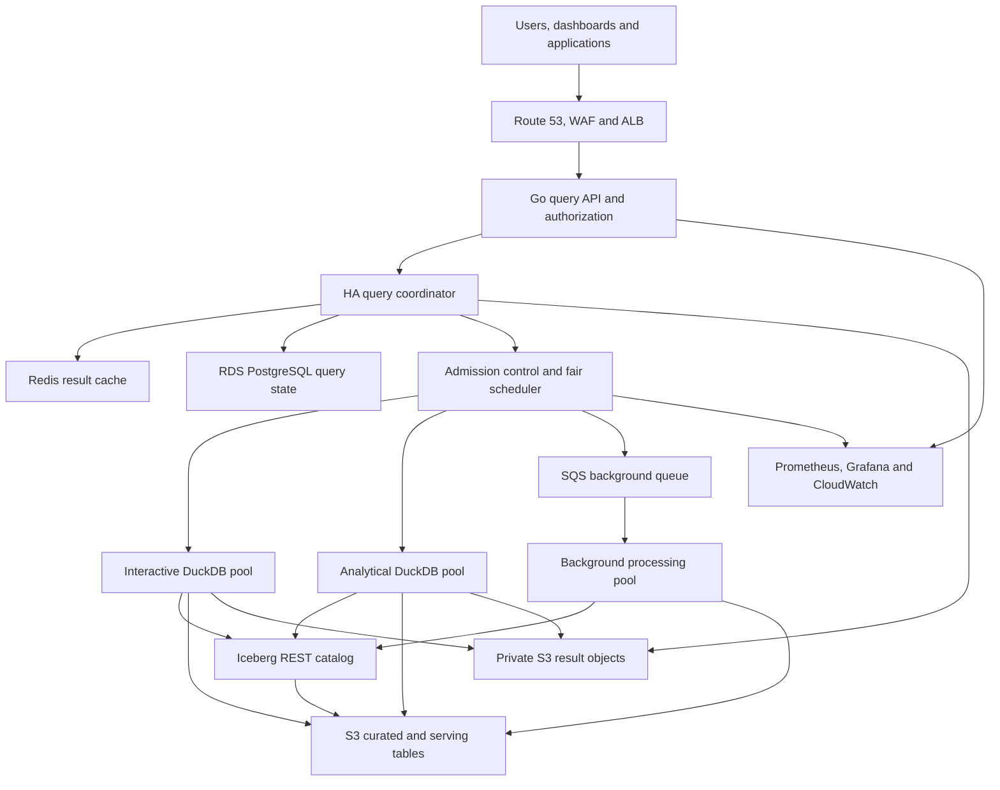
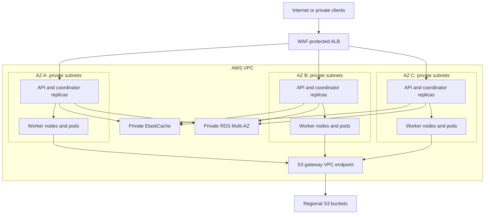
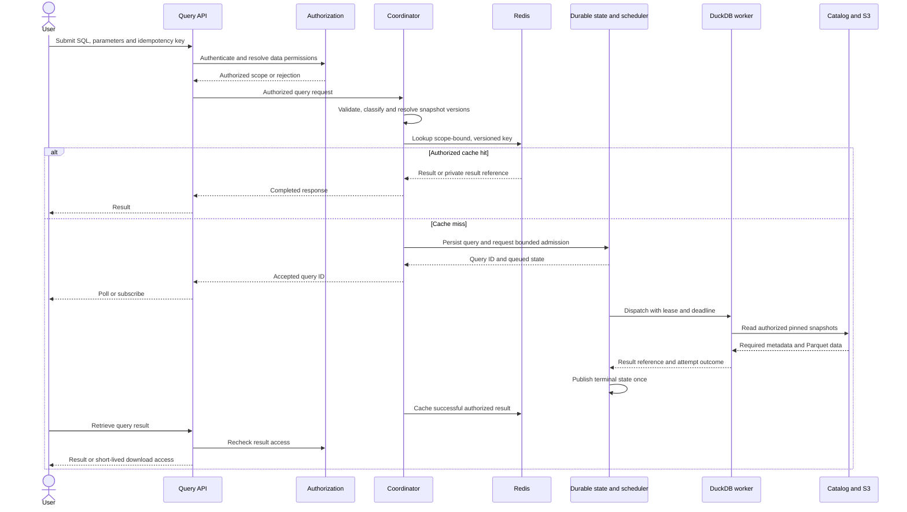
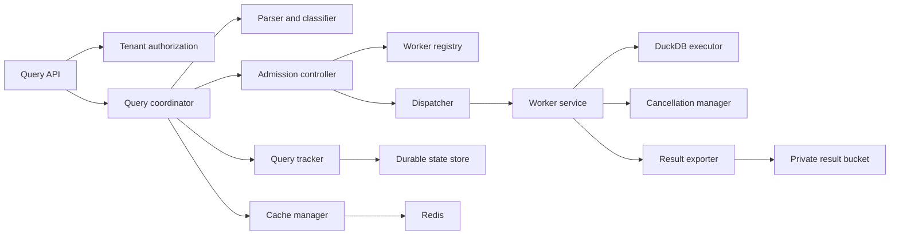
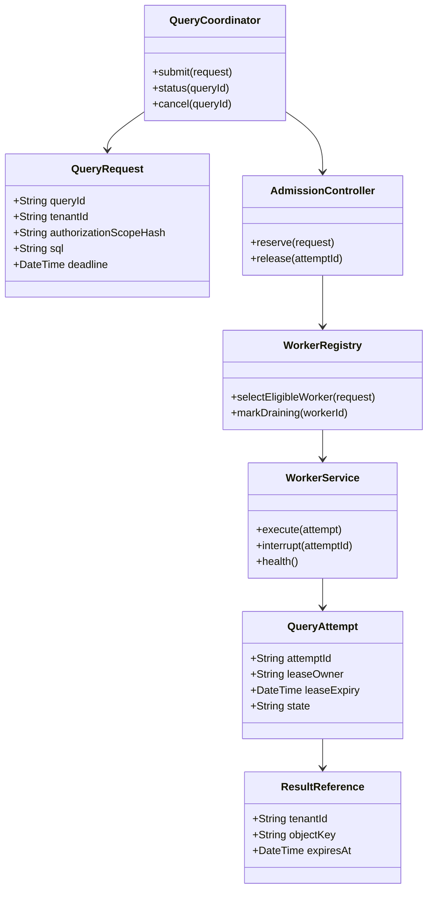
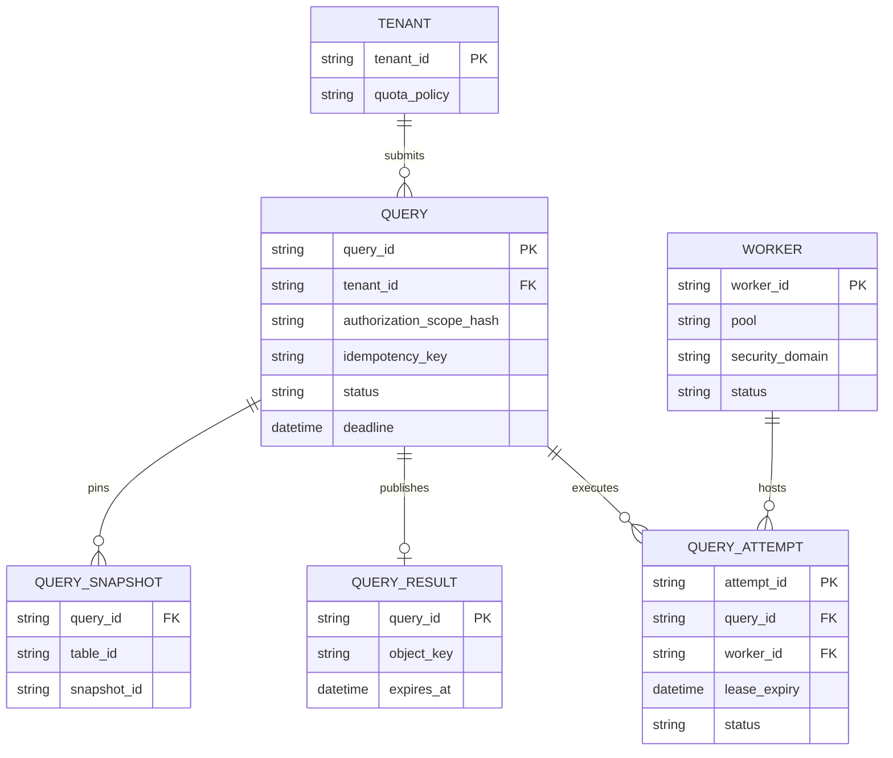
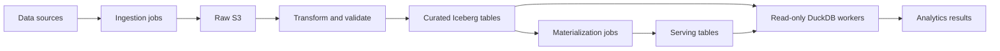
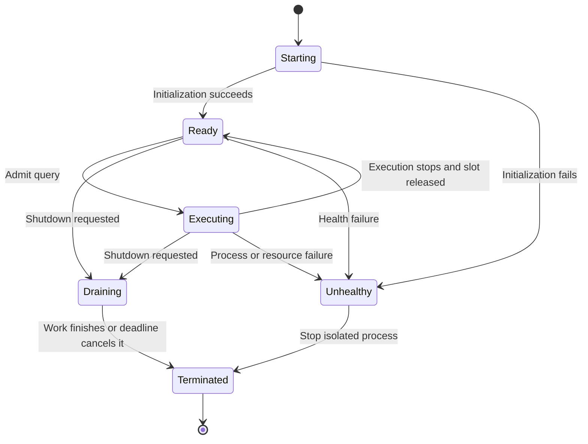

# Scalable DuckDB analytics on AWS

| | |
|---|---|
| Status | Proposed reference architecture, not an implemented or benchmarked deployment |
| Date | 2026-11-03 |
| Audience | Platform engineers, data engineers, application engineers and architecture reviewers |

This document consolidates the supplied DuckDB scaling discussion into a system-design specification for
100 TB of analytical data and 1,000 connected users with mixed dashboard, application and ad hoc workloads.
It preserves the refined 32-worker baseline rather than the earlier 14-worker sketch.

This is a standalone platform proposal. It does not describe capabilities implemented by `sqlmem`, add
dependencies to this repository, or supersede its [architecture decisions](README.md#architecture-decision-records).
For alternative Azure hosting, see the [AKS and Service Fabric companion](duckdb-azure-aks-service-fabric.md).
Sizing, latency objectives, delivery dates and costs below are planning assumptions, not measured results.
See the [documentation evidence](../evidence/2026-11-03-duckdb-architecture-documentation.md) for what was checked.

## Contents

1. [Goals and boundaries](#1-goals-and-boundaries)
2. [Architecture and technology choices](#2-architecture-and-technology-choices)
3. [AWS deployment topology](#3-aws-deployment-topology)
4. [Worker sizing and capacity](#4-worker-sizing-and-capacity)
5. [Query flow and scheduling](#5-query-flow-and-scheduling)
6. [Component design and UML](#6-component-design-and-uml)
7. [Data lake and caching](#7-data-lake-and-caching)
8. [Kubernetes configuration](#8-kubernetes-configuration)
9. [Security boundaries](#9-security-boundaries)
10. [Reliability and operations](#10-reliability-and-operations)
11. [Bottlenecks and scaling strategy](#11-bottlenecks-and-scaling-strategy)
12. [Infrastructure cost model](#12-infrastructure-cost-model)
13. [Proposed design decision record](#13-proposed-design-decision-record)
14. [Deployment and acceptance plan](#14-deployment-and-acceptance-plan)
15. [References](#15-references)

## 1. Goals and boundaries

| Dimension | Proposed requirement |
|---|---|
| Primary objective | Responsive multi-user analytical query serving |
| Data volume | 100 TB of durable analytical data in S3 |
| Users | 1,000 connected users, not 1,000 guaranteed active SQL executions |
| Workload | Dashboards, application analytics, aggregations and ad hoc joins |
| Cloud | AWS; `us-west-2` is the reference region |
| Availability | Deployment across three availability zones |
| Isolation | Tenant authorization, bounded resource use and separate workload pools |
| Submission model | Query API with asynchronous query IDs and bounded queues |
| Durability | S3 data/results and durable application/catalog metadata |

### Execution boundary

Each admitted query executes in one DuckDB worker. Horizontal scaling adds independently executing workers;
it does **not** distribute the operators of one SQL query across the fleet. Cross-worker partial-result
aggregation is outside the initial scope: arbitrary joins, ordering and distinct aggregates cannot be
distributed safely by simply splitting SQL and concatenating results.

Do not mount a shared writable native DuckDB file across worker pods. Ordinary embedded read-write access
uses one process; multiple processes may open the native file read-only when no process writes.
Current [DuckDB concurrency documentation](https://duckdb.org/docs/stable/connect/concurrency) also describes
Quack-mediated client/server access and DuckLake with a coordinated catalog. These are distinct architectures,
not permission for independent processes to write directly to a shared native file.

### Proposed service objectives

These are launch targets to negotiate and validate against a representative query corpus.

| Query class or metric | Initial objective |
|---|---|
| Cached result, p95 | Less than 500 ms |
| Dashboard serving dataset, p95 | 1-3 seconds |
| Small filtered analytical query, p95 | 1-3 seconds |
| Moderate aggregation, p95 | 3-8 seconds |
| Large analytical query, p95 | 5-30 seconds, asynchronous if needed |
| Valid interactive request availability | 99.9% over a calendar month |
| Platform-attributable query failure rate | Less than 0.1% of accepted valid queries |
| Worker replacement readiness | Less than two minutes after a single-worker failure |

Measure latency from submission through queueing, execution and result delivery, with cache hits reported
separately. Invalid SQL is excluded from platform failures; timeouts and failed accepted executions are not.
Publish overload rejection rates separately so admission control cannot conceal poor availability.
Data freshness objectives, maximum result size and tenant queue limits remain launch decisions.

If the requirement is actually 1,000 simultaneous **uncached** analytical executions with sub-three-second
latency, benchmark ClickHouse or StarRocks alongside this design before selecting the serving engine.
Use PostgreSQL or a suitable key/value store for transactional operations and point-lookups.

## 2. Architecture and technology choices



Arrows denote dependencies or access, not the physical path of result bytes. Workers return small results to
the coordinator or export large results to the private result bucket.

| Layer | Proposed technology | Purpose and trade-off |
|---|---|---|
| Edge | Route 53, AWS WAF, Application Load Balancer | DNS, request protection and TLS ingress |
| API | Go service | Submit, poll, cancel and retrieve queries; requires client integration |
| Coordinator | Replicated Go service | Classification, authorization, caching and scheduling |
| Query state | RDS PostgreSQL Multi-AZ | Durable status, tenant quotas, leases and idempotency records |
| Execution | DuckDB embedded in worker containers | Analytical execution within one worker |
| Data storage | S3 and Parquet | Durable shared storage with independent compute |
| Table management | Apache Iceberg and a compatible REST catalog | Snapshots and interoperable table metadata |
| Cache | ElastiCache Redis | Small authorized results and result metadata |
| Background queue | SQS with dead-letter handling | Durable asynchronous work; duplicate delivery must be handled |
| Orchestration | EKS | Worker isolation, scheduling and lifecycle |
| Pod scaling | HPA; KEDA for background jobs | Demand-based replicas with one scaling owner per deployment |
| Node scaling | Karpenter | Provision EC2 capacity for pending pods |
| Observability | Prometheus, Grafana and CloudWatch | Query metrics, infrastructure metrics and redacted logs |
| Infrastructure as code | Terraform | Reproducible networking, storage and managed-service provisioning |

An Iceberg REST catalog is a separate service or managed offering; PostgreSQL application metadata alone
does not implement that protocol. Choose and test the catalog before launch. DuckLake with a PostgreSQL
catalog is an alternative to evaluate, not a second required table format.

BI tools need a supported connector or adapter to the query API. The HTTP endpoints proposed here are not a
PostgreSQL wire-protocol server and are not automatically compatible with every SQL client.

## 3. AWS deployment topology



- Put API, coordinator and worker pods in private subnets. Expose only the intended ingress.
- Use an S3 gateway endpoint rather than routing bulk lake reads through NAT gateways.
- Use private connectivity for RDS, Redis and the catalog; restrict service-to-service traffic.
- Encrypt transport with TLS and storage with appropriately scoped KMS keys.
- Use EKS Pod Identity or IRSA; do not embed AWS credentials in images or manifests.
- Spread API/coordinator replicas across AZs and run them on capacity separate from analytical workers.
- Spread each worker pool using topology constraints and provision pool-specific node labels and taints.
- S3 is regional, not a bucket assigned to a worker's AZ. Cross-AZ costs still matter for RDS, Redis,
  catalog traffic and other AZ-bound services.

Illustrative worker distribution:

| Availability zone | Interactive | Analytical | Background | Total |
|---|---:|---:|---:|---:|
| A | 6 | 3 | 1 | 10 |
| B | 6 | 3 | 1 | 10 |
| C | 6 | 4 | 2 | 12 |
| **Total** | **18** | **10** | **4** | **32** |

Multi-AZ placement alone does not preserve full capacity after losing an AZ. Reserve sufficient surviving-AZ
headroom or explicitly accept degraded throughput and increased queueing during recovery.

## 4. Worker sizing and capacity

The supplied refined baseline assumes one execution worker pod per worker node.

| Pool | Nodes/pods | Reference EC2 type | vCPU/node | GiB/node | Total vCPU | Total GiB |
|---|---:|---|---:|---:|---:|---:|
| Interactive | 18 | `r7i.2xlarge` | 8 | 64 | 144 | 1,152 |
| Analytical | 10 | `r7i.2xlarge` | 8 | 64 | 80 | 640 |
| Background | 4 | `c7i.2xlarge` | 8 | 16 | 32 | 64 |
| **Total** | **32** | | | | **256** | **1,856** |

These are gross node resources, not allocatable pod resources. Account separately for the operating system,
kubelet, DaemonSets, API/coordinator nodes and catalog capacity. Validate the instance specifications and
regional availability using the [AWS instance references](#15-references).

`r7i` and `c7i` are EBS-backed choices, not local-NVMe instance-store choices. Provision suitable EBS scratch
capacity and IOPS/throughput, or select a different NVMe-equipped family and recalculate costs.
Memory-heavy background transformations need memory-optimized nodes; `c7i.2xlarge` is only a starting point
for bounded jobs that fit its memory budget.

| Worker setting | Interactive | Analytical | Background |
|---|---|---|---|
| DuckDB threads | 6 | 6-8 after profiling | 4 |
| DuckDB memory limit | 42 GB | 48 GB | 10 GB |
| Active queries initially | 1 | 1 | 1 |
| Conditional active-query ceiling | 2 lightweight | 1 heavy | 1 bounded job |
| DuckDB temporary-data cap | 150 GB | 300 GB | 150 GB |
| Priority | High | Medium | Low |

DuckDB resource settings are process/database-instance budgets, not independent allocations per query.
Two connections in one process share its resources. Some allocations are outside the buffer-manager memory
limit; retain pod headroom and monitor actual resident memory. Disk spilling helps larger-than-memory
workloads but cannot guarantee completion of every join or aggregate.

Illustrative initialization by the trusted worker service:

```sql
SET threads = 6;
SET memory_limit = '42GB';
SET temp_directory = '/mnt/duckdb-tmp';
SET max_temp_directory_size = '150GB';
SET enable_external_file_cache = true;
```

The path above is inside a Linux container. These settings are not user SQL and must not be accepted from
untrusted query requests. The custom worker application must translate its environment variables into
DuckDB configuration; DuckDB does not automatically consume the manifest's `DUCKDB_*` variables.
Pin and validate the engine and extension versions when building the worker image.

### Concurrency is an admission budget

| Pool | Initial active slots | Conditional ceiling |
|---|---:|---:|
| Interactive | 18 | 36 |
| Analytical | 10 | 10 |
| Background | 4 | 4 |
| **Total** | **32** | **50** |

Enable the 50-slot ceiling only after two-query interactive tests demonstrate safe combined CPU, memory and
latency behavior. Neither limit is a throughput measurement. A 200-request benchmark below means concurrent
submitted/in-flight requests, including queued requests, not 200 running queries on a 50-slot fleet.

For each pool, a first-order planning relationship is:

```text
uncached arrivals/second = submitted arrivals/second * (1 - result-cache hit ratio)
required active slots ~= uncached arrivals/second * mean execution seconds / target utilization
```

This is not an SLO predictor: query variance, queue bursts, cache misses and I/O contention need load tests.

## 5. Query flow and scheduling



The successful path is shown. Authentication, policy, parsing and capacity failures return explicit errors
without dispatching SQL.

### Classification and admission

| Class | Typical work | Destination |
|---|---|---|
| Q0 | Eligible authorized cache hit | Redis/private result storage |
| Q1 | Small filtered scan | Interactive pool |
| Q2 | Bounded moderate aggregation | Interactive only if budget fits; otherwise analytical |
| Q3 | Large scan, join or expensive aggregation | Dedicated analytical worker |
| Q4 | Approved transformation, compaction or materialization | Separate background job interface |

Use a SQL parser, table statistics, partition coverage, query history and measured resource use. Do not
classify solely by regular expressions or the number of joins. Public query submission remains read-only;
Q4 jobs use a separately authorized write-capable control plane.

The scheduler must:

1. Apply tenant and global limits to submissions, queued work and active resource budgets.
2. Allocate weighted fair capacity within each pool, avoiding starvation of lower-priority tenants.
3. Keep queues bounded; reject overload with `429` and retry guidance, or expose a bounded accepted query ID.
4. Aim for interactive queue waits of 1-2 seconds and analytical waits of 15-30 seconds, within the
   end-to-end deadlines. These are targets, not promises to accept indefinitely.
5. Select ready workers with sufficient memory, CPU, scratch capacity and matching authorization scope.
6. Persist ownership leases and attempt IDs so coordinator replicas cannot dispatch unbounded duplicates.
7. Propagate cancellation and deadlines to execution; release capacity only after execution stops.
8. Retry only eligible transient infrastructure failures with capped attempts, backoff and jitter.
   Do not automatically retry invalid SQL, authorization failures, OOMs or exhausted deadlines.

If the engine cannot stop a timed-out query promptly, terminate the isolated worker process and mark its
attempt failed before returning the slot. Query deadlines cover queue time, execution and retries.

## 6. Component design and UML

### Component dependency diagram



These are logical components, not a requirement to deploy a separate microservice for each box.

### UML class diagram



The UML is conceptual, not generated from repository code.

### Durable application data model



This describes application state, not the Iceberg catalog schema. Scope idempotency keys to tenant identity
and reject reuse with a different request payload. Publish one authoritative terminal result per query;
late results from expired leases must not overwrite cancellation or a newer successful attempt.

### Proposed interfaces

| Public interface | Behavior |
|---|---|
| `POST /queries` | Validate and submit; return result or `202` with query ID |
| `GET /queries/{id}` | Authorized status, queue state and explicit failure information |
| `DELETE /queries/{id}` | Request cancellation; distinguish requested from completed cancellation |
| `GET /queries/{id}/results` | Authorized bounded result or expiring private download |

| Internal worker interface | Behavior |
|---|---|
| `/health` | Process liveness; busy execution alone is not a failure |
| `/ready` | Ready for dispatch; false while starting, draining or unhealthy |
| `/execute` | Authenticated internal dispatch with lease, scope and deadline |
| `/cancel` | Interrupt a specific attempt |
| `/metrics` | Restricted operational metrics |

Choose concrete request/response schemas and error codes during implementation. No worker endpoint is
publicly accessible, and the illustrative container image below must implement these interfaces.

## 7. Data lake and caching

### Storage layout

```text
s3://ANALYTICS_LAKE/
    raw/
        events/
        transactions/
    curated/
        events/
        transactions/
    serving/
        daily_revenue/
        customer_metrics/
        product_performance/
    metadata/
        manifests/

s3://PRIVATE_QUERY_RESULTS/
    tenant-001/
    tenant-002/
```

Use separate result access policies and retention rules. Prefix names illustrate organization, not an
authorization mechanism. A 100 TB curated footprint may require additional raw, snapshot and result storage;
do not assume all zones together remain within 100 TB.



- Partition around measured filter patterns such as event date; avoid excessive partition cardinality.
- Use Parquet projection/filter pushdown and appropriate row groups; benchmark file sizes and compression.
- Compact small files and maintain statistics using the chosen table-format tooling.
- Build serving aggregates for recurring dashboards rather than rescanning raw data for every request.
- Read Iceberg through a supported catalog/snapshot interface. Raw Parquet globs over an Iceberg table can
  bypass snapshot membership, delete handling and other table semantics.
- Pin each query's table snapshot vector. For dashboards needing a coherent multi-table refresh, publish an
  application-level serving version; separate table snapshots alone do not prove cross-table consistency.
- Coordinate ingestion, compaction and snapshot expiration through the catalog. Do not delete files still
  needed by running queries, retained snapshots or recovery policies.

### Three cache layers

| Layer | Storage | Scope |
|---|---|---|
| Local external-file cache | Worker memory/engine-managed cache | Remote read reuse; evictable and not durable |
| Small result cache | Redis | Repeated dashboard/API results with bounded size and TTL |
| Large result storage | Private S3 bucket | Expiring result files, not unlimited Redis values |

Generate keys from a canonical structured encoding, not ambiguous string concatenation:

```text
SHA256(canonical_encode({
    normalized_sql,
    typed_parameters,
    tenant_id,
    authorization_scope_hash,
    policy_version,
    table_snapshot_vector,
    serving_version,
    relevant_session_settings
}))
```

Normalization must preserve SQL semantics. Recheck current authorization before cache access and result
retrieval. Treat nondeterministic functions and external mutable sources as uncacheable unless an explicit
freshness policy makes reuse correct.

Start with illustrative dashboard TTLs of 1-5 minutes only if the freshness objective permits them.
Invalidate by snapshot, serving and policy version; TTL alone is insufficient. Collapse identical authorized
cache misses to avoid refresh stampedes. Never share cached results across tenant/security scopes merely
because SQL text matches.

## 8. Kubernetes configuration

These are **illustrative templates**, not a complete deployable package. The namespace, worker image,
service account, Services, network policies, node provisioning, catalog and managed services are prerequisites.
The image reference is a placeholder. Linux mount paths are intentional.

### Interactive worker Deployment

This uses one EBS-backed scratch allocation per worker node. Provision node disk capacity above the pod's
ephemeral-storage request, including space for the node, images and DaemonSets.

```yaml
apiVersion: apps/v1
kind: Deployment
metadata:
  name: duckdb-interactive
  namespace: analytics
spec:
  replicas: 18
  selector:
    matchLabels:
      app: duckdb-interactive
  template:
    metadata:
      labels:
        app: duckdb-interactive
        pool: interactive
    spec:
      serviceAccountName: duckdb-interactive
      terminationGracePeriodSeconds: 180
      nodeSelector:
        workload: duckdb-interactive
      topologySpreadConstraints:
        - maxSkew: 1
          topologyKey: topology.kubernetes.io/zone
          whenUnsatisfiable: ScheduleAnyway
          labelSelector:
            matchLabels:
              app: duckdb-interactive
      containers:
        - name: worker
          image: YOUR_REGISTRY/duckdb-worker:PINNED_VERSION
          ports:
            - name: http
              containerPort: 8080
          env:
            - name: DUCKDB_THREADS
              value: "6"
            - name: DUCKDB_MEMORY_LIMIT
              value: "42GB"
            - name: DUCKDB_TEMP_DIRECTORY
              value: "/mnt/duckdb-tmp"
            - name: DUCKDB_MAX_TEMP_DIRECTORY_SIZE
              value: "150GB"
            - name: AWS_REGION
              value: "us-west-2"
          resources:
            requests:
              cpu: "7"
              memory: "52Gi"
              ephemeral-storage: "180Gi"
            limits:
              cpu: "8"
              memory: "54Gi"
              ephemeral-storage: "200Gi"
          volumeMounts:
            - name: scratch
              mountPath: /mnt/duckdb-tmp
          readinessProbe:
            httpGet:
              path: /ready
              port: http
            initialDelaySeconds: 10
            periodSeconds: 5
          livenessProbe:
            httpGet:
              path: /health
              port: http
            initialDelaySeconds: 30
            periodSeconds: 15
      volumes:
        - name: scratch
          emptyDir:
            sizeLimit: 180Gi
```

`emptyDir` is pod-local ephemeral storage, not automatically NVMe or a separately provisioned EBS volume.
Its disk-backed capacity comes from the node filesystem; provision and monitor that filesystem explicitly.
Do not use memory-backed `emptyDir` for large spill files.

The worker must handle SIGTERM by stopping admission, reporting not-ready, draining active queries and
terminating or cancelling them within the grace period. Longer-running analytical jobs need a matching grace
policy. Add production startup probes, pod security settings, pool taints/tolerations and disruption budgets.
`ScheduleAnyway` favors AZ balance without preventing scheduling during an AZ outage; it does not guarantee
the exact distribution in the sizing table.

### Illustrative HPA

```yaml
apiVersion: autoscaling/v2
kind: HorizontalPodAutoscaler
metadata:
  name: duckdb-interactive-hpa
  namespace: analytics
spec:
  scaleTargetRef:
    apiVersion: apps/v1
    kind: Deployment
    name: duckdb-interactive
  minReplicas: 18
  maxReplicas: 36
  metrics:
    - type: Resource
      resource:
        name: cpu
        target:
          type: Utilization
          averageUtilization: 70
  behavior:
    scaleUp:
      stabilizationWindowSeconds: 30
      policies:
        - type: Pods
          value: 4
          periodSeconds: 60
    scaleDown:
      stabilizationWindowSeconds: 300
      policies:
        - type: Pods
          value: 2
          periodSeconds: 60
```

CPU utilization is measured against CPU requests. Add tested queue-age and available-slot metrics through a
metrics adapter: CPU-only scaling misses remote-I/O waits. HPA sets pod replicas, Karpenter provisions nodes,
and the coordinator controls active query slots. Do not let independent HPA and KEDA objects fight over the
same deployment's replica count.

| Pool | Proposed minimum/baseline | Initial maximum |
|---|---:|---:|
| Interactive | 18 | 36 |
| Analytical | 10 | 24 |
| Background | 4 | 12 |
| **Total** | **32** | **72** |

This example retains the full baseline even at quiet times. Reducing minima is a later measured cost decision.
Autoscaler scale-down and node consolidation can terminate busy pods; combine graceful draining, disruption
controls and durable retry handling. A pod disruption budget alone does not protect every termination path.

## 9. Security boundaries

- Authenticate users and authorize tables, rows, columns and results before dispatch.
- Use structured parsing, bound parameters and a restricted execution interface. Read-only SQL by itself is
  not a sandbox: file readers, network functions, extension loading and exports can expose data or resources.
- Deny unapproved `ATTACH`, `INSTALL`, `LOAD`, `COPY`, file/network access functions and configuration changes
  on the public endpoint. Bootstrap approved extensions and catalog connections through trusted code.
- Restrict worker IAM, network egress and catalog permissions to its security domain. If shared-process
  credentials expose multiple tenants, use security-domain-specific workers or a verified constrained query
  interface; arbitrary SQL must not bypass tenant policy through raw S3 paths or system catalogs.
- Separate write-capable ingestion/compaction identities from read-only query workers.
- Bound query time, scanned data where enforceable, result size, scratch use, submissions and queued work.
- Keep result buckets private and use short-lived authorized downloads. Revalidate access when policies change.
- Log IDs, timing, resource usage and sanitized errors; redact credentials, sensitive literals and result values.
- Store secrets in approved secret-management facilities. Do not persist reusable credentials in DuckDB files.

These controls require implementation and adversarial tests. This documentation does not certify tenant
isolation or security. An integration with `sqlmem` must retain its existing guarded SQL/time-limit path;
the proposed service is not a replacement for those safeguards.

## 10. Reliability and operations

### Worker state diagram



Kubernetes starts a replacement pod through `Starting`; a terminated process does not become ready again.
The diagram simplifies the initial single-query worker. Under two-query admission, track each attempt and
remain executing until all active attempts stop.

| Failure | Required response |
|---|---|
| Worker/node crash | Expire ownership lease, publish failure and retry eligible read-only work within deadline |
| Coordinator replica failure | Another replica resumes durable state without duplicate authoritative results |
| AZ outage | Route to surviving replicas; retain quotas and expose reduced capacity if needed |
| Redis outage | Deliberately bypass cache with throttling and alerts; do not flood the workers |
| SQS outage | Stop accepting affected background work or durably record it for later dispatch |
| RDS/catalog outage | Fail or pause affected requests explicitly; no unversioned/unauthorized fallback |
| S3 throttling/network failure | Bounded backoff, jitter and retry budgets within the query deadline |
| Query timeout/cancellation | Stop execution, mark terminal outcome and then release resources |
| Duplicate background message | Deduplicate by job/attempt identity and use catalog-coordinated commits |

Back up RDS/application state and the catalog with tested restore procedures. Protect S3 data and metadata
according to retention and recovery policy; bucket versioning alone is not a full disaster-recovery plan.
Define RPO/RTO, regional-failure recovery and snapshot-retention requirements before production.

### Observability and runbooks

Track query submissions/second, active and queued requests, admission rejections, queue age, p50/p95/p99
end-to-end latency, execution time, scan bytes, result bytes, cache hits, retries, cancellations and failures.
Break down by workload class and suitably bounded tenant labels.

Track node/pod CPU and RSS, memory pressure, spill usage, disk IOPS/throughput, S3 request latency and errors,
network throughput, pod restarts, Redis evictions, catalog latency and database connection saturation.
Alert on deadline breaches, queue saturation, failed cancellation, low scratch space and absent worker slots.

Prepare runbooks for overload, noisy tenants, OOMs, cache loss, stuck query cancellation, catalog recovery,
AZ loss, snapshot rollback and cost spikes. Query IDs should correlate events without logging sensitive SQL.

## 11. Bottlenecks and scaling strategy

| Bottleneck | Evidence to collect | First response |
|---|---|---|
| CPU contention | Per-pool utilization and execution profiles | Reduce active slots or add workers |
| Large joins/aggregations | RSS, spill and operator timing | Dedicated workers, more memory or query redesign |
| Remote storage latency | S3 latency, request count and scan bytes | Pruning, compaction and cache reuse |
| Network saturation | Throughput and bytes/query | Smaller scans, serving aggregates and capacity tuning |
| Tiny files/metadata overhead | Files opened, catalog latency | Compaction and catalog tuning |
| Refresh stampedes | Identical concurrent misses | Request coalescing and staggered refreshes |
| Noisy tenant | Quota use and queue waits by tenant | Fair scheduling and hard limits |
| Large results | Serialization time and output bytes | Bounded previews and private result files |
| Cache/catalog bottleneck | Redis evictions and catalog/RDS latency | Size, pool connections and isolate critical services |
| Node startup lag | Pod pending time and provisioning time | Warm capacity and scheduled peak preparation |

Scale in this order:

1. Measure a representative workload on a small benchmark deployment.
2. Improve data layout, serving aggregates and cache correctness.
3. Set safe worker resource budgets and admission limits.
4. Establish the proposed baseline only if benchmark results justify it.
5. Scale individual pools using demand/queue age, slots and resource pressure.
6. Tune node provisioning, warm capacity and AZ resilience.
7. Reconsider the serving engine if latency depends on repeatedly scanning terabytes or distributing one query.

Adding workers cannot fix an inefficient single query, a saturated catalog or an object-store access pattern.

## 12. Infrastructure cost model

The following inputs come from the supplied discussion. They are **unverified planning estimates**, not current
AWS prices or a quote. The reference is Linux on-demand workers in `us-west-2`, running for 730 hours/month.

| Worker type | Count | Assumed unit cost/month | Calculated monthly cost |
|---|---:|---:|---:|
| `r7i.2xlarge` | 28 | $386.32 | $10,816.96 |
| `c7i.2xlarge` | 4 | $260.61 | $1,042.44 |
| **Worker compute** | **32** | | **$11,859.40** |

| Other component | Supplied monthly range |
|---|---:|
| S3 storage, assumed 100 TB total billable footprint | $2,200-$2,400 |
| EBS scratch and boot disks | $500-$1,300 |
| ElastiCache Redis | $500-$1,500 |
| RDS PostgreSQL | $500-$1,000 |
| EKS control plane | $73 |
| Load balancing and networking | $200-$1,000 |
| Monitoring | $300-$1,000 |
| S3 requests and miscellaneous | $100-$800 |
| **Other-component subtotal** | **$4,373-$9,073** |
| **Combined line-item estimate** | **$16,232.40-$20,932.40** |

Allow approximately **$17,000-$21,000/month for these line items only**, before contingency and omitted
components. This reconciles the supplied rounded $16,000-$22,000 budget with its actual line-item arithmetic.

API/coordinator/system nodes, a separately operated Iceberg catalog, enhanced EBS performance, extra AZ-failure
headroom, retained snapshots/raw copies, substantial egress, NAT usage, support and taxes are not fully priced
here. Storage growth and service HA configurations can materially change the result.

At the proposed 72-worker maximum, there would be 60 memory-optimized and 12 compute-optimized worker nodes.
Using the same unverified unit inputs gives **$26,306.52/month for worker compute alone** if sustained all month.
Do not reuse the baseline budget as the peak-cluster budget.

Validate all inputs in [AWS Pricing Calculator](https://calculator.aws/) with actual billable units, region,
instance availability, disk provisioned IOPS/throughput, service sizes and scaling duration. Calculate:

```text
monthly worker cost = sum(instance hourly rate * actual instance hours)
cost per successful query = allocated platform cost / successful delivered queries
```

Commit to Savings Plans only after measuring stable demand. Use Spot for interruption-tolerant background
jobs, not the primary interactive baseline. Reduce unnecessary scans, requests and idle capacity before
buying commitments.

## 13. Proposed design decision record

All decisions below are **proposed** for this standalone platform. They are not accepted repository ADRs.
Record final approvals and ownership in the implementation project's ADRs after the acceptance experiments.

| ID | Proposal and rationale | Alternatives/trade-offs | Required validation |
|---|---|---|---|
| DCP-01 | DuckDB for embedded analytical execution | Managed DuckDB or another serving engine; no automatic MPP | Mixed-workload latency and scan benchmarks |
| DCP-02 | S3/Parquet as durable shared storage | Local replicas reduce read latency but add synchronization/storage | Pruning, throughput and storage-growth tests |
| DCP-03 | Iceberg with a compatible REST catalog | DuckLake/PostgreSQL; catalog compatibility and operations matter | Snapshot, deletes, auth and writer/compaction tests |
| DCP-04 | One DuckDB process per worker pod | More processes add overhead; shared writable native files rejected | Memory accounting, cancellation and failure isolation |
| DCP-05 | HA Go coordinator with durable leases | Managed scheduling; custom service adds engineering/operational cost | Replica failure, duplicate dispatch and fairness tests |
| DCP-06 | Separate workload pools | Shared capacity is cheaper but increases interference | Noisy-neighbor and pool-saturation tests |
| DCP-07 | Scope/version-bound Redis and S3 results | No cache is simpler but costs more execution | Revocation, invalidation and stampede tests |
| DCP-08 | EKS with HPA/KEDA and Karpenter | Simpler VM/service fleet; Kubernetes adds operational complexity | Scale-up, drain and disruption tests |

No software dependency or runtime format change is made by this documentation update.

## 14. Deployment and acceptance plan

The schedule is an illustrative 12-week sequence, not an estimate based on a staffed delivery plan.

| Milestone | Illustrative window | Deliverables | Exit evidence |
|---|---|---|---|
| Foundation | Weeks 1-3 | IaC, VPC/EKS, S3, catalog, RDS/Redis, ingestion and compaction | Authorized snapshot reads and recovery smoke tests |
| Query platform | Weeks 4-6 | API, coordinator, worker image, leases, queues, quotas and cancellation | End-to-end query lifecycle and multi-tenant fairness tests |
| Performance/scaling | Weeks 7-9 | Cache, serving tables, demand metrics, HPA/KEDA, Karpenter and draining | Safe concurrency limits and measured per-class latency |
| Production readiness | Weeks 10-12 | Load/failure tests, runbooks, backup/restore and cost measurements | Approved capacity report, SLOs and operational sign-off |

### Load-test matrix

| Scenario | What it proves |
|---|---|
| 1,000 connected users at an explicit request rate | Session/API capacity and normal user traffic |
| 200 concurrent in-flight mixed requests | Execution plus bounded queue behavior, not 200 active worker slots |
| 1,000 simultaneous submissions | Fairness, bounded backlog, explicit rejection and overload recovery |
| Cold cache, then warm cache | Latency/resource behavior without hiding uncached costs |
| One heavy/noisy tenant | Authorization and resource isolation under contention |
| Worst approved large query/result | Memory, spill, output caps and cancellation behavior |
| Worker/node loss and coordinator restart | Lease recovery and authoritative result publication |
| AZ outage | Surviving capacity, degraded SLOs and restoration time |
| Cache/catalog/queue outage and S3 throttling | Explicit failure/backpressure and bounded retries |
| Data refresh, policy change and result retrieval | Snapshot consistency, freshness and access revocation |

Specify query mix, arrival rate, think time, scan bytes, result sizes, dataset distribution, cache state and
test duration before interpreting results. Record engine/extensions, image digest, instance types, node count,
pod limits, catalog configuration and infrastructure cost inputs for reproducibility.

### Launch checklist

- [ ] Confirm workload, freshness, availability denominator, queue/result caps and tenant quota policies.
- [ ] Validate catalog interoperability and pin tested engine/extension/container versions.
- [ ] Measure safe per-worker resource and active-query limits; enable two-query interactive workers only if proven.
- [ ] Meet agreed end-to-end objectives for each class, reporting queueing and overload rejections.
- [ ] Complete the load-test matrix and retain the measured capacity limits.
- [ ] Test raw-path/function bypass attempts, tenant isolation, result access and policy revocation.
- [ ] Test deadlines, cancellation, retries, duplicate messages, expired leases and late results.
- [ ] Verify graceful draining, autoscaler coordination, scratch exhaustion and AZ-failure capacity.
- [ ] Set and test RPO/RTO, catalog/database restore and snapshot-retention procedures.
- [ ] Measure cost/query and calculate baseline, peak and degraded-mode budgets from actual rates.
- [ ] Approve runbooks, alert thresholds, operational ownership and final architecture decisions.

Until this evidence exists, the platform remains a proposed design, not production-certified infrastructure.

## 15. References

Official references used to distinguish engine capabilities from application responsibilities:

- [DuckDB concurrency](https://duckdb.org/docs/stable/connect/concurrency)
- [DuckDB workload tuning and larger-than-memory limitations](https://duckdb.org/docs/stable/guides/performance/how_to_tune_workloads)
- [DuckDB configuration](https://duckdb.org/docs/stable/configuration/overview)
- [DuckDB Iceberg extension and catalog-managed access](https://duckdb.org/docs/stable/core_extensions/iceberg/overview)
- [DuckDB S3 integration](https://duckdb.org/docs/stable/core_extensions/httpfs/s3api)
- [DuckLake catalog choices](https://ducklake.select/docs/stable/duckdb/usage/choosing_a_catalog_database)
- [AWS memory-optimized instance specifications](https://docs.aws.amazon.com/ec2/latest/instancetypes/mo.html)
- [AWS compute-optimized instance specifications](https://docs.aws.amazon.com/ec2/latest/instancetypes/co.html)
- [Amazon EKS documentation](https://docs.aws.amazon.com/eks/)
- [Amazon S3 documentation](https://docs.aws.amazon.com/s3/)
- [Kubernetes HPA](https://kubernetes.io/docs/tasks/run-application/horizontal-pod-autoscale/)
- [Kubernetes ephemeral volumes](https://kubernetes.io/docs/concepts/storage/ephemeral-volumes/)
- [Karpenter](https://karpenter.sh/)
- [KEDA](https://keda.sh/docs/)
- [Apache Iceberg](https://iceberg.apache.org/docs/latest/)
- [AWS Pricing Calculator](https://calculator.aws/)

Consult documentation for the deployed versions; stable documentation URLs can change. No live deployment,
cloud pricing quote or performance measurement is asserted by this document.
