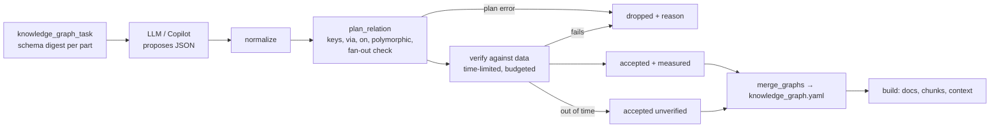

# Knowledge-graph design

The knowledge graph (ontology) names the business concepts in a database and how they relate, mapped onto tables,
filters and verified joins. It answers questions phrased in business terms ("store contacts", "online orders ship
to") that table names alone do not.

## Model

- **Entity**: `name`, `kind` (`core`, `role`, `event`, `reference`), `table`, optional `filter` (a subset, e.g.
  online orders), `key` (single or composite; default: the primary key), `label` columns, optional `is_a` parent
  (a subtype shares its parent's relations), `synonyms`, `description`, measured `rows`.
- **Relation**: `subject --predicate--> object` with a join planned by sqlmem, measured `cardinality` and a
  `verified` block (`pairs`, `unmatched`, `cardinality`).

## Lifecycle (ADR 0006)

## Join planning (ADR 0007)

| Situation | How the relation is written | What sqlmem does |
|---|---|---|
| foreign key path exists | nothing extra | shortest path over declared/curated/inferred keys |
| several direct links (e.g. main vs spare part) | `via: [kits.spare_part_id]` | uses the pinned column |
| link table with two keys to the same table | `via: [bom.assembly_id]` | joins through the link table on the pinned side |
| no foreign key | `on: "s.col = o.col"` | guard + verification of the explicit join |
| one column, several target tables | `polymorphic: {column, type_column, targets}` | one relation per target, each verified |
| auto path fans out through a shared table | (rejected) | reported with the pivot table; pin `via` or use `on` |

## Verification

For each entity: the filter runs, rows are counted, and the key is unique (composite keys included). For each
relation: the join runs, matched pairs and unmatched subject rows are counted, and the cardinality (1:1, N:1, 1:N,
M:N) is measured. Every query uses `run_select` (guard, time limit); `_Checker` stops verification when the budget
is used up and the remaining items are kept as unverified (ADR 0008).

## Use

The graph feeds docs (`knowledge-graph.md`, interactive `knowledge-graph.html`), `graph.json`, search chunks
(entities and relations), and the context pack's "Business concepts" section with ready-to-use joins. Relations of a
parent entity also match its subtypes.
