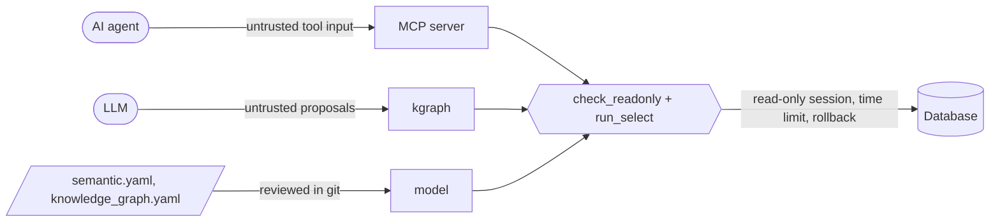

# Security design and threat model

## Assets

1. The data in the user's database (integrity: must never change; confidentiality: personal data).
2. Credentials (database passwords, LLM keys).
3. The knowledge base files (integrity: they steer every future answer).

## Trust boundaries

## Threats and controls

| # | Threat | Control | Evidence |
|---|---|---|---|
| T1 | Agent or LLM runs a write/DDL statement (`UPDATE`, `DROP`, `EXEC`, `COPY`, `INTO`) | guard: one comment-free `SELECT`/`WITH`, forbidden keywords and functions; read-only sessions; rollback | REQ-SAFE-01, REQ-SAFE-02; cross-engine `UPDATE` must fail |
| T2 | Guard bypass through engine-specific parsing (backslash escapes, dollar or q-quotes, comments) | quoting tricks rejected per dialect | `test_readonly_guard_blocks`, `test_readonly_guard_is_dialect_aware` |
| T3 | Side effects through functions (`set_config`, file readers, `load_extension`, `OPENROWSET`) | forbidden function list in the guard | `test_readonly_guard_blocks` |
| T4 | Denial of service: endless or huge queries | per-query time limits on every engine, row caps, MCP time budgets | REQ-SAFE-03, REQ-KG-08 |
| T5 | Personal data copied into the KB, prompts or embeddings | sensitive-column detection: statistics only; `--no-values`; local embeddings by default; LLM sees non-sensitive values only | REQ-SCAN-02 |
| T6 | Credentials persisted | `describe_source` renders URLs without passwords; `sqlmem.json` stores names only; keys from environment or Entra ID | review checklist; `catalog.json` source block |
| T7 | Poisoned knowledge (wrong joins/filters steer answers) | graph items verified against data; KB changes reviewed in git | REQ-KG-01, ADR 0003 |
| T8 | Prompt injection through data values or descriptions | the agent only receives text; any SQL it writes still passes T1-T4 controls | ADR 0005 |
| T9 | Supply chain (dependencies, actions) | optional extras, Dependabot for pip and actions, least-privilege workflow permissions | `.github/dependabot.yml`, CI config |

## Residual risks

- Engines without a read-only session mode (SQL Server, Oracle, warehouses) rely on the guard and rollback: use a
  read-only login.
- Pay-per-query warehouses can be charged for profiling and verification queries; scope scans with
  `--schema/--include` and `--no-profile`.
- Memories store the SQL text an agent declares verified; it is never executed by sqlmem itself, and anything an
  agent re-runs goes through `run_sql`.

Report vulnerabilities as described in [SECURITY.md](../../SECURITY.md).
