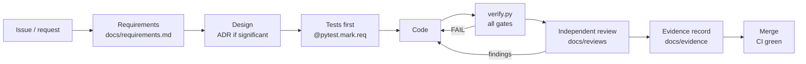

# Evidence-driven development

**Principle: a change is done when its proof exists, is reproducible, and has been checked by someone other than its
author.** This applies equally to people and to AI agents; it is what lets autonomous agents work on this repository
without eroding trust in it.

## The loop

## Artifacts

| Artifact | Where | Produced by | Proves |
|---|---|---|---|
| Requirement | `docs/requirements.md` | architect | what must be true |
| ADR | `docs/design/adr/` | architect | why it is designed this way, and how that is verified |
| Tests with `req` markers | `tests/` | implementer, test engineer | that each requirement holds |
| Evidence bundle | `build/evidence/` (CI artifact) | `scripts/verify.py` | gates, coverage, eval, traceability for one commit |
| Review record | `docs/reviews/` | reviewer | that an independent reader found no open problems |
| Evidence record | `docs/evidence/` | evidence auditor | the durable summary that ties it all to a commit |

## Gates (`scripts/verify.py`)

| Gate | Tool | Pass condition |
|---|---|---|
| lint | `ruff check` | no findings |
| format | `ruff format --check` | no changes needed |
| mypy | `mypy` (strict, `sqlmem/`; checked bodies elsewhere) | no errors |
| pyright | `pyright --warnings` (Pylance's engine) | no errors or warnings |
| tests | `pytest` + coverage | all pass, coverage ≥ 85% |
| eval | `evals.run_retrieval --embedder none` | gate in `evals/retrieval_cases.yaml` met |
| trace | requirements × test outcomes | every `REQ-*` proven; with `--require-engines`, all five engines passed |

## Rules of evidence

1. **Cite, don't claim.** "Tests pass" is a claim; "`tests` PASS 87 passed; coverage 88%" from the summary of commit
   `abc123` is evidence.
2. **Same commit.** Evidence belongs to the commit it describes. Evidence for a dirty tree says so.
3. **Measure before and after** for anything that affects quality numbers (eval, performance).
4. **Negative evidence counts.** Show the failing test before the fix; show the rejected statement for a guard rule.
5. **Gaps are written down.** What was not run (engines, manual checks) is listed under "Gaps and risks".
6. **Gates go up.** Raising a gate is a normal change; lowering one requires an ADR.

## Roles

See [agent-workflow.md](agent-workflow.md). Separation matters: the reviewer and the evidence auditor never review
their own work.
