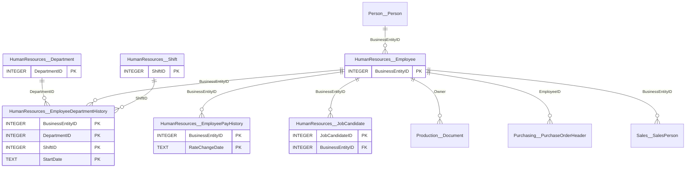
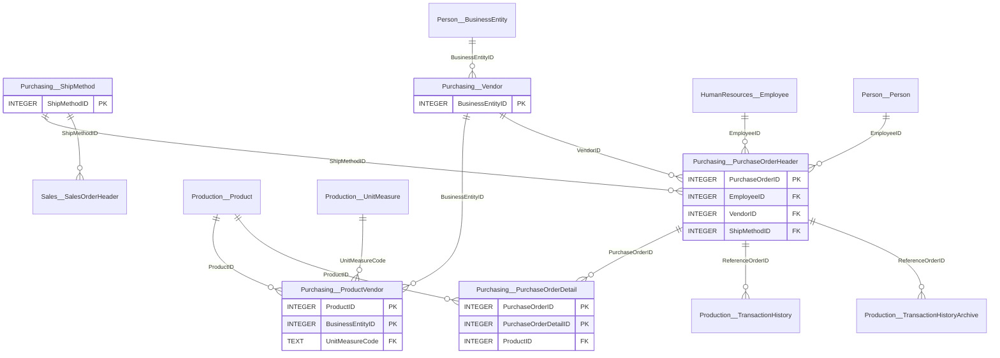
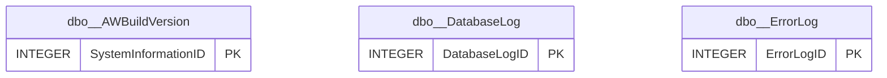

# AdventureWorks2025 - semantic knowledge base

Operational (OLTP) database of Adventure Works Cycles, a fictitious multinational manufacturer and seller of bicycles, components, clothing and accessories. Bikes are sold online to individual consumers and through sales people to resellers (bike stores) in North America, Europe and the Pacific. Covers sales, products and manufacturing, purchasing from vendors, people/addresses and HR. Sales orders run from 2022-05-30 to 2025-06-29. This is a SQLite port of the SQL Server sample; SQL Server schemas are encoded in table names as Schema__Table.

- **Source:** sqlite `AdventureWorks2025` (server 3.50.4), scanned 2026-10-30T06:03:53+00:00
- **Objects:** 71 tables/views, 486 columns, 103 relationships (90 declared, 4 inferred, 6 curated, 3 from the knowledge graph)
- **Semantic coverage:** 71/71 tables and 208/486 columns described; 10 glossary terms, 11 metrics, 19 example queries, 1 memories
- **Index:** 664 chunks, embedder `fastembed:BAAI/bge-small-en-v1.5`
- **Knowledge graph:** 62 business entities, 89 relations - [knowledge-graph.md](knowledge-graph.md), [interactive view](knowledge-graph.html)

## SQL notes for this database

- SQLite dialect: use LIMIT (not TOP), strftime()/substr() for dates, || for string concatenation, no GETDATE()/DATEPART().
- Dates are ISO-8601 TEXT like '2024-03-31T00:00:00'. Year = substr(col,1,4), month = substr(col,1,7). Filter with string comparisons: OrderDate >= '2024-01-01' AND OrderDate < '2025-01-01'.
- Boolean flags are TEXT '0'/'1' (e.g. OnlineOrderFlag = '1', MakeFlag = '1').
- Fixed-width code columns are space padded: ProductLine 'R ', Class 'H ', Style 'U ', UnitMeasureCode 'EA ', CultureID 'en    '. Compare with TRIM(col) = 'R'.
- Money columns are NUMERIC (stored as REAL); wrap aggregates in ROUND(x, 2) for presentation.
- Data ends 2025-06-29 for sales (2022 and 2025 are partial years). Interpret relative periods such as 'last year' against the latest date in the data unless the user gives explicit dates, and say which period you used.
- Quote reserved-word columns: Sales__SalesTerritory."Group", Production__ProductProductPhoto."Primary".
- A SQL Server name Schema.Table maps to Schema__Table here (Sales.SalesOrderHeader -> Sales__SalesOrderHeader).
- People, employees, stores and vendors share one key space: BusinessEntityID (Person__BusinessEntity).

## HumanResources

Employees, departments, department/shift history, pay history and job candidates.

| Table | Rows | Description |
|---|---|---|
| [HumanResources__Department](tables/HumanResources__Department.md) | 16 | Departments (Engineering, Sales, Production, ...) grouped into department groups. |
| [HumanResources__Employee](tables/HumanResources__Employee.md) | 290 | Employees: job title, hire date, demographics, hourly/salaried, vacation and sick leave |
| [HumanResources__EmployeeDepartmentHistory](tables/HumanResources__EmployeeDepartmentHistory.md) | 296 | Department and shift assignments of employees over time |
| [HumanResources__EmployeePayHistory](tables/HumanResources__EmployeePayHistory.md) | 316 | Pay rate changes per employee |
| [HumanResources__JobCandidate](tables/HumanResources__JobCandidate.md) | 13 | Resumes (XML) submitted by job applicants; BusinessEntityID is set if the candidate was hired. |
| [HumanResources__Shift](tables/HumanResources__Shift.md) | 3 | Work shifts (Day, Evening, Night) with start and end times. |

## Person

People and business entities with their addresses, e-mail, phones, contact roles, countries and states/provinces.

| Table | Rows | Description |
|---|---|---|
| [Person__Address](tables/Person__Address.md) | 19,614 | Street addresses of customers, employees, stores and vendors. |
| [Person__AddressType](tables/Person__AddressType.md) | 6 | Types of addresses (Billing, Home, Main Office, Primary, Shipping, Archive). |
| [Person__BusinessEntity](tables/Person__BusinessEntity.md) | 20,777 | Source of the BusinessEntityID shared by people, stores and vendors (the common key for addresses and contacts). |
| [Person__BusinessEntityAddress](tables/Person__BusinessEntityAddress.md) | 19,614 | Cross-reference mapping people, stores and vendors to their addresses (with address type). |
| [Person__BusinessEntityContact](tables/Person__BusinessEntityContact.md) | 909 | Cross-reference mapping stores and vendors to their contact people (with contact type). |
| [Person__ContactType](tables/Person__ContactType.md) | 20 | Roles of business contacts (Owner, Purchasing Agent, Marketing Manager, ...). |
| [Person__CountryRegion](tables/Person__CountryRegion.md) | 238 | ISO country/region codes and names. |
| [Person__EmailAddress](tables/Person__EmailAddress.md) | 19,972 | E-mail addresses of people. |
| [Person__Password](tables/Person__Password.md) | 19,972 | One-way hashed passwords of people (never select these columns). |
| [Person__Person](tables/Person__Person.md) | 19,972 | Every human known to Adventure Works: employees, sales people, individual customers, store and vendor contacts |
| [Person__PersonPhone](tables/Person__PersonPhone.md) | 19,972 | Phone numbers of people with phone type. |
| [Person__PhoneNumberType](tables/Person__PhoneNumberType.md) | 3 | Phone number types (Cell, Home, Work). |
| [Person__StateProvince](tables/Person__StateProvince.md) | 181 | States and provinces with their country and sales territory. |

```mermaid
erDiagram
    Person__Address {
        INTEGER AddressID PK
        INTEGER StateProvinceID FK
    }
    Person__AddressType {
        INTEGER AddressTypeID PK
    }
    Person__BusinessEntity {
        INTEGER BusinessEntityID PK
    }
    Person__BusinessEntityAddress {
        INTEGER BusinessEntityID PK
        INTEGER AddressID PK
        INTEGER AddressTypeID PK
    }
    Person__BusinessEntityContact {
        INTEGER BusinessEntityID PK
        INTEGER PersonID PK
        INTEGER ContactTypeID PK
    }
    Person__ContactType {
        INTEGER ContactTypeID PK
    }
    Person__CountryRegion {
        TEXT CountryRegionCode PK
    }
    Person__EmailAddress {
        INTEGER BusinessEntityID PK
        INTEGER EmailAddressID PK
    }
    Person__Password {
        INTEGER BusinessEntityID PK
    }
    Person__Person {
        INTEGER BusinessEntityID PK
    }
    Person__PersonPhone {
        INTEGER BusinessEntityID PK
        TEXT PhoneNumber PK
        INTEGER PhoneNumberTypeID PK
    }
    Person__PhoneNumberType {
        INTEGER PhoneNumberTypeID PK
    }
    Person__StateProvince {
        INTEGER StateProvinceID PK
        TEXT CountryRegionCode FK
        INTEGER TerritoryID FK
    }
    Person__Person ||--o{ HumanResources__Employee : "BusinessEntityID"
    Person__StateProvince ||--o{ Person__Address : "StateProvinceID"
    Person__Address ||--o{ Person__BusinessEntityAddress : "AddressID"
    Person__AddressType ||--o{ Person__BusinessEntityAddress : "AddressTypeID"
    Person__BusinessEntity ||--o{ Person__BusinessEntityAddress : "BusinessEntityID"
    Person__Person ||--o{ Person__BusinessEntityContact : "PersonID"
    Person__ContactType ||--o{ Person__BusinessEntityContact : "ContactTypeID"
    Person__BusinessEntity ||--o{ Person__BusinessEntityContact : "BusinessEntityID"
    Person__Person ||--o{ Person__EmailAddress : "BusinessEntityID"
    Person__Person ||--o{ Person__Password : "BusinessEntityID"
    Person__BusinessEntity ||--o{ Person__Person : "BusinessEntityID"
    Person__Person ||--o{ Person__PersonPhone : "BusinessEntityID"
    Person__PhoneNumberType ||--o{ Person__PersonPhone : "PhoneNumberTypeID"
    Person__CountryRegion ||--o{ Person__StateProvince : "CountryRegionCode"
    Sales__SalesTerritory ||--o{ Person__StateProvince : "TerritoryID"
    Person__BusinessEntity ||--o{ Purchasing__Vendor : "BusinessEntityID"
    Person__CountryRegion ||--o{ Sales__CountryRegionCurrency : "CountryRegionCode"
    Person__Person ||--o{ Sales__Customer : "PersonID"
    Person__Person ||--o{ Sales__PersonCreditCard : "BusinessEntityID"
    Person__Address ||--o{ Sales__SalesOrderHeader : "BillToAddressID"
    Person__Address ||--o{ Sales__SalesOrderHeader : "ShipToAddressID"
    Person__StateProvince ||--o{ Sales__SalesTaxRate : "StateProvinceID"
    Person__CountryRegion ||--o{ Sales__SalesTerritory : "CountryRegionCode"
    Person__BusinessEntity ||--o{ Sales__Store : "BusinessEntityID"
    Person__Person ||--o{ Sales__SalesPerson : "BusinessEntityID"
    Person__Person ||--o{ Sales__SalesOrderHeader : "SalesPersonID"
    Person__Person ||--o{ Purchasing__PurchaseOrderHeader : "EmployeeID"
```

## Production

Products and their category hierarchy, models, descriptions and photos, bill of materials, inventory, work orders/routing (manufacturing), cost/price history and inventory transactions.

| Table | Rows | Description |
|---|---|---|
| [Production__BillOfMaterials](tables/Production__BillOfMaterials.md) | 2,679 | Bill of materials: components required to build each product assembly (hierarchical parent/child). |
| [Production__Culture](tables/Production__Culture.md) | 8 | Languages in which product descriptions are stored |
| [Production__Document](tables/Production__Document.md) | 12 | Product maintenance documents (hierarchical folders and documents). |
| [Production__Illustration](tables/Production__Illustration.md) | 5 | Bicycle assembly diagrams (XML). |
| [Production__Location](tables/Production__Location.md) | 14 | Inventory and manufacturing locations (work centers such as Frame Welding, Paint, Final Assembly, and storage areas). |
| [Production__Product](tables/Production__Product.md) | 504 | Products sold or used in manufacturing: bikes, components, clothing and accessories, with pricing, cost, attributes and lifecycle dates. |
| [Production__ProductCategory](tables/Production__ProductCategory.md) | 4 | Top level of the product hierarchy: Bikes, Components, Clothing, Accessories. |
| [Production__ProductCostHistory](tables/Production__ProductCostHistory.md) | 395 | History of product standard costs (StartDate/EndDate; EndDate NULL = current) |
| [Production__ProductDescription](tables/Production__ProductDescription.md) | 762 | Product descriptions (marketing text) in several languages. |
| [Production__ProductDocument](tables/Production__ProductDocument.md) | 32 | Cross-reference mapping products to related documents. |
| [Production__ProductInventory](tables/Production__ProductInventory.md) | 1,069 | Current inventory quantity of each product per location (shelf/bin). |
| [Production__ProductListPriceHistory](tables/Production__ProductListPriceHistory.md) | 395 | History of product list prices (StartDate/EndDate; EndDate NULL = current). |
| [Production__ProductModel](tables/Production__ProductModel.md) | 128 | Product models: a model groups product variants (sizes/colors), e.g |
| [Production__ProductModelIllustration](tables/Production__ProductModelIllustration.md) | 7 | Cross-reference mapping product models to illustrations. |
| [Production__ProductModelProductDescriptionCulture](tables/Production__ProductModelProductDescriptionCulture.md) | 762 | Cross-reference mapping product models to their descriptions per language (CultureID is space padded, e.g |
| [Production__ProductPhoto](tables/Production__ProductPhoto.md) | 101 | Product images (thumbnail and large photo blobs). |
| [Production__ProductProductPhoto](tables/Production__ProductProductPhoto.md) | 504 | Cross-reference mapping products to their photos. |
| [Production__ProductReview](tables/Production__ProductReview.md) | 4 | Customer reviews of products. |
| [Production__ProductSubcategory](tables/Production__ProductSubcategory.md) | 37 | Second level of the product hierarchy (e.g |
| [Production__ScrapReason](tables/Production__ScrapReason.md) | 16 | Manufacturing failure (scrap) reasons. |
| [Production__TransactionHistory](tables/Production__TransactionHistory.md) | 113,443 | Inventory transactions (sales, purchases, work orders) from 2024-07-30 onward |
| [Production__TransactionHistoryArchive](tables/Production__TransactionHistoryArchive.md) | 89,253 | Inventory transactions before 2024-07-30 (archive of Production__TransactionHistory, same columns). |
| [Production__UnitMeasure](tables/Production__UnitMeasure.md) | 38 | Unit of measure lookup |
| [Production__WorkOrder](tables/Production__WorkOrder.md) | 72,591 | Manufacturing work orders: product, quantity to build, scrapped quantity and dates. |
| [Production__WorkOrderRouting](tables/Production__WorkOrderRouting.md) | 67,131 | Manufacturing steps (routing) of each work order: location, planned vs actual dates, hours and cost. |

```mermaid
erDiagram
    Production__BillOfMaterials {
        INTEGER BillOfMaterialsID PK
        INTEGER ProductAssemblyID FK
        INTEGER ComponentID FK
        TEXT UnitMeasureCode FK
    }
    Production__Culture {
        TEXT CultureID PK
    }
    Production__Document {
        BLOB DocumentNode PK
        INTEGER Owner FK
    }
    Production__Illustration {
        INTEGER IllustrationID PK
    }
    Production__Location {
        INTEGER LocationID PK
    }
    Production__Product {
        INTEGER ProductID PK
        TEXT SizeUnitMeasureCode FK
        TEXT WeightUnitMeasureCode FK
        INTEGER ProductSubcategoryID FK
        INTEGER ProductModelID FK
    }
    Production__ProductCategory {
        INTEGER ProductCategoryID PK
    }
    Production__ProductCostHistory {
        INTEGER ProductID PK
        TEXT StartDate PK
    }
    Production__ProductDescription {
        INTEGER ProductDescriptionID PK
    }
    Production__ProductDocument {
        INTEGER ProductID PK
        BLOB DocumentNode PK
    }
    Production__ProductInventory {
        INTEGER ProductID PK
        INTEGER LocationID PK
    }
    Production__ProductListPriceHistory {
        INTEGER ProductID PK
        TEXT StartDate PK
    }
    Production__ProductModel {
        INTEGER ProductModelID PK
    }
    Production__ProductModelIllustration {
        INTEGER ProductModelID PK
        INTEGER IllustrationID PK
    }
    Production__ProductModelProductDescriptionCulture {
        INTEGER ProductModelID PK
        INTEGER ProductDescriptionID PK
        TEXT CultureID PK
    }
    Production__ProductPhoto {
        INTEGER ProductPhotoID PK
    }
    Production__ProductProductPhoto {
        INTEGER ProductID PK
        INTEGER ProductPhotoID PK
    }
    Production__ProductReview {
        INTEGER ProductReviewID PK
        INTEGER ProductID FK
    }
    Production__ProductSubcategory {
        INTEGER ProductSubcategoryID PK
        INTEGER ProductCategoryID FK
    }
    Production__ScrapReason {
        INTEGER ScrapReasonID PK
    }
    Production__TransactionHistory {
        INTEGER TransactionID PK
        INTEGER ProductID FK
    }
    Production__TransactionHistoryArchive {
        INTEGER TransactionID PK
        INTEGER ProductID FK
    }
    Production__UnitMeasure {
        TEXT UnitMeasureCode PK
    }
    Production__WorkOrder {
        INTEGER WorkOrderID PK
        INTEGER ProductID FK
        INTEGER ScrapReasonID FK
    }
    Production__WorkOrderRouting {
        INTEGER WorkOrderID PK
        INTEGER ProductID PK
        INTEGER OperationSequence PK
        INTEGER LocationID FK
    }
    Production__Product ||--o{ Production__BillOfMaterials : "ProductAssemblyID"
    Production__Product ||--o{ Production__BillOfMaterials : "ComponentID"
    Production__UnitMeasure ||--o{ Production__BillOfMaterials : "UnitMeasureCode"
    HumanResources__Employee ||--o{ Production__Document : "Owner"
    Production__UnitMeasure ||--o{ Production__Product : "SizeUnitMeasureCode"
    Production__UnitMeasure ||--o{ Production__Product : "WeightUnitMeasureCode"
    Production__ProductModel ||--o{ Production__Product : "ProductModelID"
    Production__ProductSubcategory ||--o{ Production__Product : "ProductSubcategoryID"
    Production__Product ||--o{ Production__ProductCostHistory : "ProductID"
    Production__Product ||--o{ Production__ProductDocument : "ProductID"
    Production__Document ||--o{ Production__ProductDocument : "DocumentNode"
    Production__Location ||--o{ Production__ProductInventory : "LocationID"
    Production__Product ||--o{ Production__ProductInventory : "ProductID"
    Production__Product ||--o{ Production__ProductListPriceHistory : "ProductID"
    Production__ProductModel ||--o{ Production__ProductModelIllustration : "ProductModelID"
    Production__Illustration ||--o{ Production__ProductModelIllustration : "IllustrationID"
    Production__ProductDescription ||--o{ Production__ProductModelProductDescriptionCulture : "ProductDescriptionID"
    Production__Culture ||--o{ Production__ProductModelProductDescriptionCulture : "CultureID"
    Production__ProductModel ||--o{ Production__ProductModelProductDescriptionCulture : "ProductModelID"
    Production__Product ||--o{ Production__ProductProductPhoto : "ProductID"
    Production__ProductPhoto ||--o{ Production__ProductProductPhoto : "ProductPhotoID"
    Production__Product ||--o{ Production__ProductReview : "ProductID"
    Production__ProductCategory ||--o{ Production__ProductSubcategory : "ProductCategoryID"
    Production__Product ||--o{ Production__TransactionHistory : "ProductID"
    Production__Product ||--o{ Production__WorkOrder : "ProductID"
    Production__ScrapReason ||--o{ Production__WorkOrder : "ScrapReasonID"
    Production__Location ||--o{ Production__WorkOrderRouting : "LocationID"
    Production__WorkOrder ||--o{ Production__WorkOrderRouting : "WorkOrderID"
    Production__Product ||--o{ Purchasing__ProductVendor : "ProductID"
    Production__UnitMeasure ||--o{ Purchasing__ProductVendor : "UnitMeasureCode"
    Production__Product ||--o{ Purchasing__PurchaseOrderDetail : "ProductID"
    Production__Product ||--o{ Sales__ShoppingCartItem : "ProductID"
    Production__Product ||--o{ Sales__SpecialOfferProduct : "ProductID"
    Sales__SalesOrderHeader ||--o{ Production__TransactionHistory : "ReferenceOrderID"
    Purchasing__PurchaseOrderHeader ||--o{ Production__TransactionHistory : "ReferenceOrderID"
    Production__WorkOrder ||--o{ Production__TransactionHistory : "ReferenceOrderID"
    Production__Product ||--o{ Production__TransactionHistoryArchive : "ProductID"
    Production__Product ||--o{ Production__WorkOrderRouting : "ProductID"
    Production__Product ||--o{ Sales__SalesOrderDetail : "ProductID"
    Sales__SalesOrderHeader ||--o{ Production__TransactionHistoryArchive : "ReferenceOrderID"
    Purchasing__PurchaseOrderHeader ||--o{ Production__TransactionHistoryArchive : "ReferenceOrderID"
    Production__WorkOrder ||--o{ Production__TransactionHistoryArchive : "ReferenceOrderID"
```

## Purchasing

Vendors, the products they supply, purchase orders and shipping methods.

| Table | Rows | Description |
|---|---|---|
| [Purchasing__ProductVendor](tables/Purchasing__ProductVendor.md) | 460 | Which vendors supply which products, with lead time, prices and order quantity limits. |
| [Purchasing__PurchaseOrderDetail](tables/Purchasing__PurchaseOrderDetail.md) | 8,845 | Purchase order lines (products ordered from vendors). |
| [Purchasing__PurchaseOrderHeader](tables/Purchasing__PurchaseOrderHeader.md) | 4,012 | Purchase orders to vendors: vendor, employee who created it, status, dates, shipping and totals. |
| [Purchasing__ShipMethod](tables/Purchasing__ShipMethod.md) | 5 | Shipping companies/methods used for sales and purchase orders. |
| [Purchasing__Vendor](tables/Purchasing__Vendor.md) | 104 | Companies from which Adventure Works purchases parts and other goods. |

## Sales

Customers (individuals and reseller stores), sales orders and lines, sales people and quotas, territories, special offers, currencies, credit cards and sales tax.

| Table | Rows | Description |
|---|---|---|
| [Sales__CountryRegionCurrency](tables/Sales__CountryRegionCurrency.md) | 109 | Cross-reference mapping countries/regions to their ISO currency codes. |
| [Sales__CreditCard](tables/Sales__CreditCard.md) | 19,118 | Customer credit card information. |
| [Sales__Currency](tables/Sales__Currency.md) | 105 | Lookup of ISO currency codes and names. |
| [Sales__CurrencyRate](tables/Sales__CurrencyRate.md) | 13,532 | Daily currency exchange rates from USD to other currencies. |
| [Sales__Customer](tables/Sales__Customer.md) | 19,820 | Customers |
| [Sales__PersonCreditCard](tables/Sales__PersonCreditCard.md) | 19,118 | Cross-reference mapping people to their credit cards. |
| [Sales__SalesOrderDetail](tables/Sales__SalesOrderDetail.md) | 121,317 | Individual products (order lines) of each sales order: product, quantity, unit price, discount and line total. |
| [Sales__SalesOrderHeader](tables/Sales__SalesOrderHeader.md) | 31,465 | General sales order information: one row per customer order, with dates, customer, channel, sales person, territory, addresses, payment and order totals. |
| [Sales__SalesOrderHeaderSalesReason](tables/Sales__SalesOrderHeaderSalesReason.md) | 27,647 | Cross-reference mapping sales orders to the purchase reasons given (online orders). |
| [Sales__SalesPerson](tables/Sales__SalesPerson.md) | 17 | Sales representatives (employees) with their territory, quota, bonus, commission and year-to-date sales |
| [Sales__SalesPersonQuotaHistory](tables/Sales__SalesPersonQuotaHistory.md) | 163 | Sales quota history per sales person and quota date (quarterly quotas). |
| [Sales__SalesReason](tables/Sales__SalesReason.md) | 10 | Lookup of reasons customers give for a purchase (price, promotion, advertising, quality, ...). |
| [Sales__SalesTaxRate](tables/Sales__SalesTaxRate.md) | 29 | Tax rates per state/province. |
| [Sales__SalesTerritory](tables/Sales__SalesTerritory.md) | 10 | Sales territories: 5 US regions (Northwest, Northeast, Central, Southwest, Southeast) plus Canada, France, Germany, Australia and United Kingdom, grouped into N |
| [Sales__SalesTerritoryHistory](tables/Sales__SalesTerritoryHistory.md) | 17 | History of sales person assignments to territories (StartDate/EndDate; EndDate NULL = current). |
| [Sales__ShoppingCartItem](tables/Sales__ShoppingCartItem.md) | 3 | Online shopping cart contents until the order is submitted or cancelled (only test rows here). |
| [Sales__SpecialOffer](tables/Sales__SpecialOffer.md) | 16 | Promotions and discounts (volume discounts, seasonal sales, clearance, etc.). |
| [Sales__SpecialOfferProduct](tables/Sales__SpecialOfferProduct.md) | 538 | Cross-reference of which products are eligible for which special offers. |
| [Sales__Store](tables/Sales__Store.md) | 701 | Reseller customers: bike shops that buy Adventure Works products for resale. |

```mermaid
erDiagram
    Sales__CountryRegionCurrency {
        TEXT CountryRegionCode PK
        TEXT CurrencyCode PK
    }
    Sales__CreditCard {
        INTEGER CreditCardID PK
    }
    Sales__Currency {
        TEXT CurrencyCode PK
    }
    Sales__CurrencyRate {
        INTEGER CurrencyRateID PK
        TEXT FromCurrencyCode FK
        TEXT ToCurrencyCode FK
    }
    Sales__Customer {
        INTEGER CustomerID PK
        INTEGER PersonID FK
        INTEGER StoreID FK
        INTEGER TerritoryID FK
    }
    Sales__PersonCreditCard {
        INTEGER BusinessEntityID PK
        INTEGER CreditCardID PK
    }
    Sales__SalesOrderDetail {
        INTEGER SalesOrderID PK
        INTEGER SalesOrderDetailID PK
        INTEGER ProductID FK
        INTEGER SpecialOfferID FK
    }
    Sales__SalesOrderHeader {
        INTEGER SalesOrderID PK
        INTEGER CustomerID FK
        INTEGER SalesPersonID FK
        INTEGER TerritoryID FK
        INTEGER BillToAddressID FK
        INTEGER ShipToAddressID FK
        INTEGER ShipMethodID FK
        INTEGER CreditCardID FK
        INTEGER CurrencyRateID FK
    }
    Sales__SalesOrderHeaderSalesReason {
        INTEGER SalesOrderID PK
        INTEGER SalesReasonID PK
    }
    Sales__SalesPerson {
        INTEGER BusinessEntityID PK
        INTEGER TerritoryID FK
    }
    Sales__SalesPersonQuotaHistory {
        INTEGER BusinessEntityID PK
        TEXT QuotaDate PK
    }
    Sales__SalesReason {
        INTEGER SalesReasonID PK
    }
    Sales__SalesTaxRate {
        INTEGER SalesTaxRateID PK
        INTEGER StateProvinceID FK
    }
    Sales__SalesTerritory {
        INTEGER TerritoryID PK
        TEXT CountryRegionCode FK
    }
    Sales__SalesTerritoryHistory {
        INTEGER BusinessEntityID PK
        INTEGER TerritoryID PK
        TEXT StartDate PK
    }
    Sales__ShoppingCartItem {
        INTEGER ShoppingCartItemID PK
        INTEGER ProductID FK
    }
    Sales__SpecialOffer {
        INTEGER SpecialOfferID PK
    }
    Sales__SpecialOfferProduct {
        INTEGER SpecialOfferID PK
        INTEGER ProductID PK
    }
    Sales__Store {
        INTEGER BusinessEntityID PK
        INTEGER SalesPersonID FK
    }
    Sales__SalesTerritory ||--o{ Person__StateProvince : "TerritoryID"
    Person__CountryRegion ||--o{ Sales__CountryRegionCurrency : "CountryRegionCode"
    Sales__Currency ||--o{ Sales__CountryRegionCurrency : "CurrencyCode"
    Sales__Currency ||--o{ Sales__CurrencyRate : "FromCurrencyCode"
    Sales__Currency ||--o{ Sales__CurrencyRate : "ToCurrencyCode"
    Person__Person ||--o{ Sales__Customer : "PersonID"
    Sales__Store ||--o{ Sales__Customer : "StoreID"
    Sales__SalesTerritory ||--o{ Sales__Customer : "TerritoryID"
    Person__Person ||--o{ Sales__PersonCreditCard : "BusinessEntityID"
    Sales__CreditCard ||--o{ Sales__PersonCreditCard : "CreditCardID"
    Sales__SalesOrderHeader ||--o{ Sales__SalesOrderDetail : "SalesOrderID"
    Sales__SpecialOfferProduct ||--o{ Sales__SalesOrderDetail : "SpecialOfferID,ProductID"
    Person__Address ||--o{ Sales__SalesOrderHeader : "BillToAddressID"
    Person__Address ||--o{ Sales__SalesOrderHeader : "ShipToAddressID"
    Sales__CreditCard ||--o{ Sales__SalesOrderHeader : "CreditCardID"
    Sales__CurrencyRate ||--o{ Sales__SalesOrderHeader : "CurrencyRateID"
    Sales__Customer ||--o{ Sales__SalesOrderHeader : "CustomerID"
    Sales__SalesPerson ||--o{ Sales__SalesOrderHeader : "SalesPersonID"
    Purchasing__ShipMethod ||--o{ Sales__SalesOrderHeader : "ShipMethodID"
    Sales__SalesTerritory ||--o{ Sales__SalesOrderHeader : "TerritoryID"
    Sales__SalesReason ||--o{ Sales__SalesOrderHeaderSalesReason : "SalesReasonID"
    Sales__SalesOrderHeader ||--o{ Sales__SalesOrderHeaderSalesReason : "SalesOrderID"
    HumanResources__Employee ||--o{ Sales__SalesPerson : "BusinessEntityID"
    Sales__SalesTerritory ||--o{ Sales__SalesPerson : "TerritoryID"
    Sales__SalesPerson ||--o{ Sales__SalesPersonQuotaHistory : "BusinessEntityID"
    Person__StateProvince ||--o{ Sales__SalesTaxRate : "StateProvinceID"
    Person__CountryRegion ||--o{ Sales__SalesTerritory : "CountryRegionCode"
    Sales__SalesPerson ||--o{ Sales__SalesTerritoryHistory : "BusinessEntityID"
    Sales__SalesTerritory ||--o{ Sales__SalesTerritoryHistory : "TerritoryID"
    Production__Product ||--o{ Sales__ShoppingCartItem : "ProductID"
    Production__Product ||--o{ Sales__SpecialOfferProduct : "ProductID"
    Sales__SpecialOffer ||--o{ Sales__SpecialOfferProduct : "SpecialOfferID"
    Person__BusinessEntity ||--o{ Sales__Store : "BusinessEntityID"
    Sales__SalesPerson ||--o{ Sales__Store : "SalesPersonID"
    Person__Person ||--o{ Sales__SalesPerson : "BusinessEntityID"
    Person__Person ||--o{ Sales__SalesOrderHeader : "SalesPersonID"
    Sales__SalesOrderHeader ||--o{ Production__TransactionHistory : "ReferenceOrderID"
    Production__Product ||--o{ Sales__SalesOrderDetail : "ProductID"
    Sales__SpecialOffer ||--o{ Sales__SalesOrderDetail : "SpecialOfferID"
    Sales__SalesOrderHeader ||--o{ Production__TransactionHistoryArchive : "ReferenceOrderID"
```

## dbo

Technical tables: build version, DDL audit log and error log. Not business data.

| Table | Rows | Description |
|---|---|---|
| [dbo__AWBuildVersion](tables/dbo__AWBuildVersion.md) | 1 | Current version number of the AdventureWorks sample database (technical). |
| [dbo__DatabaseLog](tables/dbo__DatabaseLog.md) | 934 | Audit log of DDL changes made to the database (technical, not business data). |
| [dbo__ErrorLog](tables/dbo__ErrorLog.md) | 0 | Errors captured by the database's error-handling procedure (technical, empty). |

## Metrics

- **Sales revenue**: Net sales excluding tax and freight. Order level: SUM(SubTotal). Line level (by product): SUM(LineTotal) - both give the same total. `SUM(Sales__SalesOrderHeader.SubTotal)`
- **Gross billed amount**: Amount invoiced to customers including tax and freight. `SUM(Sales__SalesOrderHeader.TotalDue)`
- **Order count**: Number of sales orders. `COUNT(DISTINCT Sales__SalesOrderHeader.SalesOrderID)`
- **Units sold**: Number of product units sold. `SUM(Sales__SalesOrderDetail.OrderQty)`
- **Average order value**: Net sales revenue divided by number of orders. `SUM(Sales__SalesOrderHeader.SubTotal) / COUNT(*)`
- **Discount amount**: Value of price discounts granted on order lines. `SUM(Sales__SalesOrderDetail.OrderQty * Sales__SalesOrderDetail.UnitPrice * Sales__SalesOrderDetail.UnitPriceDiscount)`
- **Gross margin**: Approximate: line revenue minus quantity x current standard cost. For period-accurate cost use Production__ProductCostHistory. `SUM(Sales__SalesOrderDetail.LineTotal - Sales__SalesOrderDetail.OrderQty * Production__Product.StandardCost)`
- **Purchase spend**: Amount ordered from vendors excluding tax and freight; usually exclude rejected orders (Status = 3). `SUM(Purchasing__PurchaseOrderHeader.SubTotal)`
- **Inventory on hand**: Units currently in stock, summed over all locations. `SUM(Production__ProductInventory.Quantity)`
- **Scrap rate**: Share of work-order quantity that failed inspection. `1.0 * SUM(Production__WorkOrder.ScrappedQty) / SUM(Production__WorkOrder.OrderQty)`
- **Quota attainment**: Sales person year-to-date sales divided by their sales quota. `Sales__SalesPerson.SalesYTD / Sales__SalesPerson.SalesQuota`

## Glossary

- **Individual customer**: A Sales__Customer with PersonID set and StoreID NULL (Person__Person.PersonType = 'IN'). Buys online (OnlineOrderFlag = '1').
- **Reseller**: A Sales__Customer with StoreID set; the store name is Sales__Store.Name. Reseller orders are placed by a sales person (OnlineOrderFlag = '0').
- **Sales channel**: Online/internet channel = OnlineOrderFlag = '1' (individual customers, no sales person). Reseller channel = OnlineOrderFlag = '0' (stores, with SalesPersonID).
- **Product hierarchy**: Production__ProductCategory (Bikes, Components, Clothing, Accessories) -> Production__ProductSubcategory -> Production__Product. Products without a subcategory are internal components.
- **Region / territory group**: Sales__SalesTerritory."Group" groups territories into North America, Europe and Pacific; Name is the territory (5 US regions or a country).
- **Current department**: The HumanResources__EmployeeDepartmentHistory row with EndDate IS NULL.
- **Current pay rate**: Per employee, the HumanResources__EmployeePayHistory row with the latest RateChangeDate (ROW_NUMBER() OVER (PARTITION BY BusinessEntityID ORDER BY RateChangeDate DESC) = 1).
- **Full inventory transaction history**: Production__TransactionHistory holds transactions from 2024-07-30; Production__TransactionHistoryArchive holds earlier ones. UNION ALL both tables for complete history.
- **Finished good**: Product with FinishedGoodsFlag = '1'. MakeFlag = '1' means manufactured in-house, '0' purchased.
- **Active product**: Product still for sale: SellEndDate IS NULL and DiscontinuedDate IS NULL.

## Example questions

- Net sales revenue and order count by year
- Monthly order count and revenue trend
- Revenue by sales territory in 2024
- Online vs reseller sales by year
- Top 10 products by revenue
- Revenue by product category and subcategory
- Gross margin by product category (approximate, current standard cost)
- Sales people ranked by year-to-date sales with quota attainment
- Top 10 resellers (stores) by revenue
- Top 10 individual customers by revenue
- Revenue by ship-to country
- Discount amount and revenue by special offer
- Purchase reasons given by customers
- Current number of employees per department
- Current pay rate of each employee with job title and department
- Products at or below their reorder point (inventory across all locations)
- Top 10 vendors by purchase spend
- Scrap quantity and scrap rate by scrap reason
- Full inventory transaction history of one product (current + archive)
