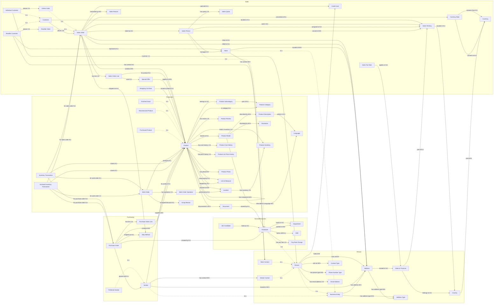

# AdventureWorks2025 - knowledge graph

62 business entities and 89 relations mapped onto the database. Edit [knowledge_graph.yaml](../knowledge_graph.yaml) to change it; explore it in the [interactive view](knowledge-graph.html).

## Entities

| Entity | Kind | Stored in | Key | Rows | Description |
|---|---|---|---|---|---|
| **Department** | reference | `HumanResources__Department` | DepartmentID | 16 | Company department, grouped into department groups. |
| **Employee** (is a Person) | core | `HumanResources__Employee` | BusinessEntityID | 290 | Adventure Works employee with job title, hire date and HR details; the name is in Person. |
| **Job Candidate** | core | `HumanResources__JobCandidate` | JobCandidateID | 13 | Job applicant with a resume; linked to the employee record when hired. |
| **Pay Rate Change** | event | `HumanResources__EmployeePayHistory` | BusinessEntityID, RateChangeDate | 316 | An employee's hourly pay rate from a given date; the latest one is the current rate. |
| **Shift** | reference | `HumanResources__Shift` | ShiftID | 3 | Work shift (day, evening, night). |
| **Address** | core | `Person__Address` | AddressID | 19,614 | Street address of a person, store or vendor; also used as bill-to/ship-to address of orders. |
| **Address Type** | reference | `Person__AddressType` | AddressTypeID | 6 | Role of a business entity address, such as billing, shipping or home. |
| **Business Entity** | core | `Person__BusinessEntity` | BusinessEntityID | 20,777 | Shared identity (BusinessEntityID) of every person, store and vendor; addresses and contacts hang off it. |
| **Contact Type** | reference | `Person__ContactType` | ContactTypeID | 20 | Role a contact person plays for a store or vendor (owner, purchasing agent, ...). |
| **Country** | reference | `Person__CountryRegion` | CountryRegionCode | 238 | Country or region (ISO code and name). |
| **Email Address** | core | `Person__EmailAddress` | EmailAddressID | 19,972 | Email address associated with a person. |
| **Person** (is a Business Entity) | core | `Person__Person` | BusinessEntityID | 19,972 | Any human known to Adventure Works: employees, sales people, individual customers and store/vendor contacts. |
| **Phone Number Type** | reference | `Person__PhoneNumberType` | PhoneNumberTypeID | 3 | Type of a person's phone number, such as work, home or cell. |
| **State or Province** | reference | `Person__StateProvince` | StateProvinceID | 181 | State, province or region of a country, mapped to a sales territory. |
| **Store Contact** (is a Person) | role | `Person__Person WHERE PersonType = 'SC'` | BusinessEntityID | 753 | Person who is the contact for a reseller store. |
| **Vendor Contact** (is a Person) | role | `Person__Person WHERE PersonType = 'VC'` | BusinessEntityID | 156 | Person who is the contact for a vendor. |
| **Archived Inventory Transaction** | event | `Production__TransactionHistoryArchive` | TransactionID | 89,253 | Stock movement before 2024-07-30 (archive of inventory transactions). |
| **Document** | core | `Production__Document` | DocumentNode | 12 | Product maintenance document or folder, owned by an employee. |
| **Finished Good** (is a Product) | role | `Production__Product WHERE FinishedGoodsFlag = '1'` | ProductID | 295 | Product that is salable (FinishedGoodsFlag = 1). |
| **Illustration** | core | `Production__Illustration` | IllustrationID | 5 | Bicycle assembly diagram stored as XML. |
| **Inventory Transaction** | event | `Production__TransactionHistory` | TransactionID | 113,443 | Stock movement from a sales order, purchase order or work order since 2024-07-30. |
| **Language** | reference | `Production__Culture` | CultureID | 8 | Language (culture) in which product descriptions are written. |
| **Location** | reference | `Production__Location` | LocationID | 14 | Inventory or manufacturing location (work center or storage area). |
| **Manufactured Product** (is a Product) | role | `Production__Product WHERE MakeFlag = '1'` | ProductID | 239 | Product made in-house (MakeFlag = 1). |
| **Product** | core | `Production__Product` | ProductID | 504 | Something sold or used in manufacturing: bikes, components, clothing and accessories. |
| **Product Category** | reference | `Production__ProductCategory` | ProductCategoryID | 4 | Top level of the product hierarchy: Bikes, Components, Clothing, Accessories. |
| **Product Cost History** | event | `Production__ProductCostHistory` | ProductID, StartDate | 395 | Standard cost of a product for a period (EndDate NULL = current). |
| **Product Description** | reference | `Production__ProductDescription` | ProductDescriptionID | 762 | Marketing description of a product model in one language. |
| **Product Inventory** | core | `Production__ProductInventory` | ProductID, LocationID | 1,069 | On-hand product quantity at a specific manufacturing or storage location and shelf/bin. |
| **Product List Price History** | event | `Production__ProductListPriceHistory` | ProductID, StartDate | 395 | List price of a product for a period (EndDate NULL = current). |
| **Product Model** | core | `Production__ProductModel` | ProductModelID | 128 | Product model that groups product variants (sizes, colors), e.g. Mountain-100. |
| **Product Photo** | core | `Production__ProductPhoto` | ProductPhotoID | 101 | Product image files, including thumbnail and large-photo filenames. |
| **Product Review** | event | `Production__ProductReview` | ProductReviewID | 4 | Customer review of a product with a 1-5 rating. |
| **Product Subcategory** | reference | `Production__ProductSubcategory` | ProductSubcategoryID | 37 | Second level of the product hierarchy (Mountain Bikes, Helmets, Jerseys, ...). |
| **Purchased Product** (is a Product) | role | `Production__Product WHERE MakeFlag = '0'` | ProductID | 265 | Product bought from vendors rather than made (MakeFlag = 0). |
| **Scrap Reason** | reference | `Production__ScrapReason` | ScrapReasonID | 16 | Reason a manufactured quantity failed inspection. |
| **Unit of Measure** | reference | `Production__UnitMeasure` | UnitMeasureCode | 38 | Measurement units used for product dimensions, quantities and vendor supply units. |
| **Work Order** | event | `Production__WorkOrder` | WorkOrderID | 72,591 | Manufacturing order to build a quantity of a product, with scrapped quantity and dates. |
| **Work Order Operation** | event | `Production__WorkOrderRouting` | WorkOrderID, ProductID, OperationSequence | 67,131 | Manufacturing step of a work order at a location, with planned vs actual dates, hours and cost. |
| **Preferred Vendor** (is a Vendor) | role | `Purchasing__Vendor WHERE PreferredVendorStatus = '1'` | BusinessEntityID | 93 | Vendor preferred over others that supply the same product. |
| **Purchase Order** | event | `Purchasing__PurchaseOrderHeader` | PurchaseOrderID | 4,012 | Order placed with a vendor by an employee, with status, dates and totals. |
| **Purchase Order Line** | event | `Purchasing__PurchaseOrderDetail` | PurchaseOrderDetailID | 8,845 | One product ordered from a vendor with ordered, received, rejected and stocked quantities. |
| **Ship Method** | reference | `Purchasing__ShipMethod` | ShipMethodID | 5 | Shipping company/method used for sales and purchase orders. |
| **Vendor** (is a Business Entity) | core | `Purchasing__Vendor` | BusinessEntityID | 104 | Company Adventure Works buys parts and goods from. |
| **Credit Card** | core | `Sales__CreditCard` | CreditCardID | 19,118 | Payment card used for sales orders. |
| **Currency** | reference | `Sales__Currency` | CurrencyCode | 105 | ISO currency. |
| **Currency Rate** | reference | `Sales__CurrencyRate` | CurrencyRateID | 13,532 | Daily exchange rate from US dollars to another currency. |
| **Customer** | core | `Sales__Customer` | CustomerID | 19,820 | A buyer of Adventure Works products: an individual consumer or a reseller store account. |
| **Individual Customer** (is a Customer) | role | `Sales__Customer WHERE StoreID IS NULL` | CustomerID | 18,484 | Consumer who buys online; the customer record points to a person and has no store. |
| **Online Order** (is a Sales Order) | role | `Sales__SalesOrderHeader WHERE OnlineOrderFlag = '1'` | SalesOrderID | 27,659 | Sales order placed on the internet by an individual customer. |
| **Reseller Customer** (is a Customer) | role | `Sales__Customer WHERE StoreID IS NOT NULL` | CustomerID | 1,336 | Customer account of a reseller store; its orders are taken by sales people. |
| **Reseller Order** (is a Sales Order) | role | `Sales__SalesOrderHeader WHERE OnlineOrderFlag = '0'` | SalesOrderID | 3,806 | Sales order placed by a sales person for a reseller store. |
| **Sales Order** | event | `Sales__SalesOrderHeader` | SalesOrderID | 31,465 | A customer order with dates, channel, territory, payment and totals (SubTotal = net revenue). |
| **Sales Order Line** | event | `Sales__SalesOrderDetail` | SalesOrderDetailID | 121,317 | One product on a sales order with quantity, unit price, discount and line total. |
| **Sales Person** (is a Employee) | role | `Sales__SalesPerson` | BusinessEntityID | 17 | Employee who sells to resellers, with territory, quota, bonus, commission and year-to-date sales. |
| **Sales Quota** | event | `Sales__SalesPersonQuotaHistory` | BusinessEntityID, QuotaDate | 163 | Quarterly sales quota of a sales person. |
| **Sales Reason** | reference | `Sales__SalesReason` | SalesReasonID | 10 | Reason a customer gives for buying (price, promotion, advertising, quality ...). |
| **Sales Tax Rate** | reference | `Sales__SalesTaxRate` | SalesTaxRateID | 29 | Sales tax rate of a state or province (retail, wholesale or all sales). |
| **Sales Territory** | reference | `Sales__SalesTerritory` | TerritoryID | 10 | Sales region (five US regions or a country) grouped into North America, Europe and Pacific. |
| **Shopping Cart Item** | event | `Sales__ShoppingCartItem` | ShoppingCartItemID | 3 | Product and quantity held in an online shopping cart before order submission or cancellation. |
| **Special Offer** | reference | `Sales__SpecialOffer` | SpecialOfferID | 16 | Promotion or discount (volume discount, seasonal sale, clearance) for resellers or customers. |
| **Store** (is a Business Entity) | core | `Sales__Store` | BusinessEntityID | 701 | Reseller: a bike shop that buys Adventure Works products for resale. |

## Relations

| Relation | Cardinality | In the data | Join |
|---|---|---|---|
| Customer **places** Sales Order | 1:N | 31,465 pairs | `FROM Sales__Customer s JOIN Sales__SalesOrderHeader o ON o.CustomerID = s.CustomerID` |
| Individual Customer **places** Online Order | 1:N | 27,659 pairs | `FROM (SELECT * FROM Sales__Customer WHERE StoreID IS NULL) s JOIN (SELECT * FROM Sales__SalesOrderHeader WHERE OnlineOrderFlag = '1') o ON o.CustomerID = s.CustomerID` |
| Reseller Customer **places** Reseller Order | 1:N | 3,806 pairs | `FROM (SELECT * FROM Sales__Customer WHERE StoreID IS NOT NULL) s JOIN (SELECT * FROM Sales__SalesOrderHeader WHERE OnlineOrderFlag = '0') o ON o.CustomerID = s.CustomerID` |
| Individual Customer **is person** Person | 1:1 | 18,484 pairs | `FROM (SELECT * FROM Sales__Customer WHERE StoreID IS NULL) s JOIN Person__Person o ON s.PersonID = o.BusinessEntityID` |
| Reseller Customer **represents** Store | N:1 | 1,336 pairs | `FROM (SELECT * FROM Sales__Customer WHERE StoreID IS NOT NULL) s JOIN Sales__Store o ON s.StoreID = o.BusinessEntityID` |
| Customer **located in** Sales Territory | N:1 | 19,820 pairs | `FROM Sales__Customer s JOIN Sales__SalesTerritory o ON s.TerritoryID = o.TerritoryID` |
| Sales Order **sold in** Sales Territory | N:1 | 31,465 pairs | `FROM Sales__SalesOrderHeader s JOIN Sales__SalesTerritory o ON s.TerritoryID = o.TerritoryID` |
| Sales Order **taken by** Sales Person | N:1 | 3,806 pairs | `FROM Sales__SalesOrderHeader s JOIN Sales__SalesPerson o ON s.SalesPersonID = o.BusinessEntityID` |
| Sales Order **has line** Sales Order Line | 1:N | 121,317 pairs | `FROM Sales__SalesOrderHeader s JOIN Sales__SalesOrderDetail o ON o.SalesOrderID = s.SalesOrderID` |
| Sales Order **contains** Product | M:N | 121,317 pairs | `FROM Sales__SalesOrderHeader s JOIN Sales__SalesOrderDetail v1 ON v1.SalesOrderID = s.SalesOrderID JOIN Production__Product o ON v1.ProductID = o.ProductID` |
| Sales Order Line **for product** Product | N:1 | 121,317 pairs | `FROM Sales__SalesOrderDetail s JOIN Production__Product o ON s.ProductID = o.ProductID` |
| Sales Order Line **uses** Special Offer | N:1 | 121,317 pairs | `FROM Sales__SalesOrderDetail s JOIN Sales__SpecialOffer o ON s.SpecialOfferID = o.SpecialOfferID` |
| Sales Order **paid with** Credit Card | N:1 | 30,334 pairs | `FROM Sales__SalesOrderHeader s JOIN Sales__CreditCard o ON s.CreditCardID = o.CreditCardID` |
| Sales Order **converted at** Currency Rate | N:1 | 13,976 pairs | `FROM Sales__SalesOrderHeader s JOIN Sales__CurrencyRate o ON s.CurrencyRateID = o.CurrencyRateID` |
| Sales Order **shipped via** Ship Method | N:1 | 31,465 pairs | `FROM Sales__SalesOrderHeader s JOIN Purchasing__ShipMethod o ON s.ShipMethodID = o.ShipMethodID` |
| Sales Order **ships to** Address | N:1 | 31,465 pairs | `FROM Sales__SalesOrderHeader s JOIN Person__Address o ON s.ShipToAddressID = o.AddressID` |
| Sales Order **billed to** Address | N:1 | 31,465 pairs | `FROM Sales__SalesOrderHeader s JOIN Person__Address o ON s.BillToAddressID = o.AddressID` |
| Sales Order **motivated by** Sales Reason | M:N | 27,647 pairs | `FROM Sales__SalesOrderHeader s JOIN Sales__SalesOrderHeaderSalesReason v1 ON v1.SalesOrderID = s.SalesOrderID JOIN Sales__SalesReason o ON v1.SalesReasonID = o.SalesReasonID` |
| Special Offer **applies to** Product | M:N | 538 pairs | `FROM Sales__SpecialOffer s JOIN Sales__SpecialOfferProduct v1 ON v1.SpecialOfferID = s.SpecialOfferID JOIN Production__Product o ON v1.ProductID = o.ProductID` |
| Sales Person **assigned to** Sales Territory | N:1 | 14 pairs | `FROM Sales__SalesPerson s JOIN Sales__SalesTerritory o ON s.TerritoryID = o.TerritoryID` |
| Sales Person **served in** Sales Territory | M:N | 17 pairs | `FROM Sales__SalesPerson s JOIN Sales__SalesTerritoryHistory v1 ON v1.BusinessEntityID = s.BusinessEntityID JOIN Sales__SalesTerritory o ON v1.TerritoryID = o.TerritoryID` |
| Sales Person **manages** Store | 1:N | 701 pairs | `FROM Sales__SalesPerson s JOIN Sales__Store o ON o.SalesPersonID = s.BusinessEntityID` |
| Sales Person **has quota** Sales Quota | 1:N | 163 pairs | `FROM Sales__SalesPerson s JOIN Sales__SalesPersonQuotaHistory o ON o.BusinessEntityID = s.BusinessEntityID` |
| Person **holds** Credit Card | M:N | 19,118 pairs | `FROM Person__Person s JOIN Sales__PersonCreditCard v1 ON v1.BusinessEntityID = s.BusinessEntityID JOIN Sales__CreditCard o ON v1.CreditCardID = o.CreditCardID` |
| Currency Rate **converts from** Currency | N:1 | 13,532 pairs | `FROM Sales__CurrencyRate s JOIN Sales__Currency o ON s.FromCurrencyCode = o.CurrencyCode` |
| Currency Rate **converts to** Currency | N:1 | 13,532 pairs | `FROM Sales__CurrencyRate s JOIN Sales__Currency o ON s.ToCurrencyCode = o.CurrencyCode` |
| Country **uses** Currency | M:N | 109 pairs | `FROM Person__CountryRegion s JOIN Sales__CountryRegionCurrency v1 ON v1.CountryRegionCode = s.CountryRegionCode JOIN Sales__Currency o ON v1.CurrencyCode = o.CurrencyCode` |
| Sales Tax Rate **applies in** State or Province | N:1 | 29 pairs | `FROM Sales__SalesTaxRate s JOIN Person__StateProvince o ON s.StateProvinceID = o.StateProvinceID` |
| Sales Territory **located in** Country | N:1 | 10 pairs | `FROM Sales__SalesTerritory s JOIN Person__CountryRegion o ON s.CountryRegionCode = o.CountryRegionCode` |
| State or Province **part of** Sales Territory | N:1 | 181 pairs | `FROM Person__StateProvince s JOIN Sales__SalesTerritory o ON s.TerritoryID = o.TerritoryID` |
| State or Province **belongs to** Country | N:1 | 181 pairs | `FROM Person__StateProvince s JOIN Person__CountryRegion o ON s.CountryRegionCode = o.CountryRegionCode` |
| Address **located in** State or Province | N:1 | 19,614 pairs | `FROM Person__Address s JOIN Person__StateProvince o ON s.StateProvinceID = o.StateProvinceID` |
| Person **lives at** Address | M:N | 18,798 pairs | `FROM Person__Person s JOIN Person__BusinessEntity v1 ON s.BusinessEntityID = v1.BusinessEntityID JOIN Person__BusinessEntityAddress v2 ON v2.BusinessEntityID = v1.BusinessEntityID JOIN Person__Address o ON v2.AddressID = o.AddressID` |
| Store **located at** Address | M:N | 712 pairs | `FROM Sales__Store s JOIN Person__BusinessEntity v1 ON s.BusinessEntityID = v1.BusinessEntityID JOIN Person__BusinessEntityAddress v2 ON v2.BusinessEntityID = v1.BusinessEntityID JOIN Person__Address o ON v2.AddressID = o.AddressID` |
| Vendor **located at** Address | M:N | 104 pairs | `FROM Purchasing__Vendor s JOIN Person__BusinessEntity v1 ON s.BusinessEntityID = v1.BusinessEntityID JOIN Person__BusinessEntityAddress v2 ON v2.BusinessEntityID = v1.BusinessEntityID JOIN Person__Address o ON v2.AddressID = o.AddressID` |
| Store **has contact** Store Contact | M:N | 753 pairs | `FROM Sales__Store s JOIN Person__BusinessEntity v1 ON s.BusinessEntityID = v1.BusinessEntityID JOIN Person__BusinessEntityContact v2 ON v2.BusinessEntityID = v1.BusinessEntityID JOIN (SELECT * FROM Person__Person WHERE PersonType = 'SC') o ON v2.PersonID = o.BusinessEntityID` |
| Vendor **has contact** Vendor Contact | M:N | 156 pairs | `FROM Purchasing__Vendor s JOIN Person__BusinessEntity v1 ON s.BusinessEntityID = v1.BusinessEntityID JOIN Person__BusinessEntityContact v2 ON v2.BusinessEntityID = v1.BusinessEntityID JOIN (SELECT * FROM Person__Person WHERE PersonType = 'VC') o ON v2.PersonID = o.BusinessEntityID` |
| Person **acts as** Contact Type | M:N | 909 pairs | `FROM Person__Person s JOIN Person__BusinessEntityContact v1 ON v1.PersonID = s.BusinessEntityID JOIN Person__ContactType o ON v1.ContactTypeID = o.ContactTypeID` |
| Employee **works in** Department | N:1 | 290 pairs | `FROM HumanResources__Employee s JOIN HumanResources__EmployeeDepartmentHistory v1 ON v1.BusinessEntityID = s.BusinessEntityID JOIN HumanResources__Department o ON v1.DepartmentID = o.DepartmentID WHERE v1.EndDate IS NULL` |
| Employee **worked in** Department | M:N | 296 pairs | `FROM HumanResources__Employee s JOIN HumanResources__EmployeeDepartmentHistory v1 ON v1.BusinessEntityID = s.BusinessEntityID JOIN HumanResources__Department o ON v1.DepartmentID = o.DepartmentID` |
| Employee **works shift** Shift | N:1 | 290 pairs | `FROM HumanResources__Employee s JOIN HumanResources__EmployeeDepartmentHistory v1 ON v1.BusinessEntityID = s.BusinessEntityID JOIN HumanResources__Shift o ON v1.ShiftID = o.ShiftID WHERE v1.EndDate IS NULL` |
| Employee **has pay rate** Pay Rate Change | 1:N | 316 pairs | `FROM HumanResources__Employee s JOIN HumanResources__EmployeePayHistory o ON o.BusinessEntityID = s.BusinessEntityID` |
| Job Candidate **hired as** Employee | N:1 | 2 pairs | `FROM HumanResources__JobCandidate s JOIN HumanResources__Employee o ON s.BusinessEntityID = o.BusinessEntityID` |
| Document **owned by** Employee | N:1 | 12 pairs | `FROM Production__Document s JOIN HumanResources__Employee o ON s.Owner = o.BusinessEntityID` |
| Product **belongs to** Product Subcategory | N:1 | 295 pairs | `FROM Production__Product s JOIN Production__ProductSubcategory o ON s.ProductSubcategoryID = o.ProductSubcategoryID` |
| Product Subcategory **part of** Product Category | N:1 | 37 pairs | `FROM Production__ProductSubcategory s JOIN Production__ProductCategory o ON s.ProductCategoryID = o.ProductCategoryID` |
| Product **in category** Product Category | N:1 | 295 pairs | `FROM Production__Product s JOIN Production__ProductSubcategory v1 ON s.ProductSubcategoryID = v1.ProductSubcategoryID JOIN Production__ProductCategory o ON v1.ProductCategoryID = o.ProductCategoryID` |
| Product **based on** Product Model | N:1 | 295 pairs | `FROM Production__Product s JOIN Production__ProductModel o ON s.ProductModelID = o.ProductModelID` |
| Product Model **described by** Product Description | M:N | 762 pairs | `FROM Production__ProductModel s JOIN Production__ProductModelProductDescriptionCulture v1 ON v1.ProductModelID = s.ProductModelID JOIN Production__ProductDescription o ON v1.ProductDescriptionID = o.ProductDescriptionID` |
| Product Description **written in** Language | N:1 | 762 pairs | `FROM Production__ProductDescription s JOIN Production__ProductModelProductDescriptionCulture v1 ON v1.ProductDescriptionID = s.ProductDescriptionID JOIN Production__Culture o ON v1.CultureID = o.CultureID` |
| Product **has component** Product | M:N | 2,576 pairs | `FROM Production__Product s JOIN Production__BillOfMaterials v1 ON v1.ProductAssemblyID = s.ProductID JOIN Production__Product o ON v1.ComponentID = o.ProductID` |
| Product **stocked at** Location | M:N | 1,069 pairs | `FROM Production__Product s JOIN Production__ProductInventory v1 ON v1.ProductID = s.ProductID JOIN Production__Location o ON v1.LocationID = o.LocationID` |
| Product **has review** Product Review | 1:N | 4 pairs | `FROM Production__Product s JOIN Production__ProductReview o ON o.ProductID = s.ProductID` |
| Product **has cost history** Product Cost History | 1:N | 395 pairs | `FROM Production__Product s JOIN Production__ProductCostHistory o ON o.ProductID = s.ProductID` |
| Product **has price history** Product List Price History | 1:N | 395 pairs | `FROM Production__Product s JOIN Production__ProductListPriceHistory o ON o.ProductID = s.ProductID` |
| Product **documented in** Document | M:N | 32 pairs | `FROM Production__Product s JOIN Production__ProductDocument v1 ON v1.ProductID = s.ProductID JOIN Production__Document o ON v1.DocumentNode = o.DocumentNode` |
| Work Order **produces** Product | N:1 | 72,591 pairs | `FROM Production__WorkOrder s JOIN Production__Product o ON s.ProductID = o.ProductID` |
| Work Order **scrapped because** Scrap Reason | N:1 | 729 pairs | `FROM Production__WorkOrder s JOIN Production__ScrapReason o ON s.ScrapReasonID = o.ScrapReasonID` |
| Work Order **has operation** Work Order Operation | 1:N | 67,131 pairs | `FROM Production__WorkOrder s JOIN Production__WorkOrderRouting o ON o.WorkOrderID = s.WorkOrderID` |
| Work Order Operation **performed at** Location | N:1 | 67,131 pairs | `FROM Production__WorkOrderRouting s JOIN Production__Location o ON s.LocationID = o.LocationID` |
| Inventory Transaction **moves** Product | N:1 | 113,443 pairs | `FROM Production__TransactionHistory s JOIN Production__Product o ON s.ProductID = o.ProductID` |
| Archived Inventory Transaction **moves** Product | N:1 | 89,253 pairs | `FROM Production__TransactionHistoryArchive s JOIN Production__Product o ON s.ProductID = o.ProductID` |
| Inventory Transaction **for sales order** Sales Order | N:1 | 74,575 pairs | `FROM Production__TransactionHistory s JOIN Sales__SalesOrderHeader o ON s.ReferenceOrderID = o.SalesOrderID AND (s.TransactionType = 'S')` |
| Inventory Transaction **for purchase order** Purchase Order | N:1 | 7,866 pairs | `FROM Production__TransactionHistory s JOIN Purchasing__PurchaseOrderHeader o ON s.ReferenceOrderID = o.PurchaseOrderID AND (s.TransactionType = 'P')` |
| Inventory Transaction **for work order** Work Order | N:1 | 31,002 pairs | `FROM Production__TransactionHistory s JOIN Production__WorkOrder o ON s.ReferenceOrderID = o.WorkOrderID AND (s.TransactionType = 'W')` |
| Vendor **supplies** Product | M:N | 460 pairs | `FROM Purchasing__Vendor s JOIN Purchasing__ProductVendor v1 ON v1.BusinessEntityID = s.BusinessEntityID JOIN Production__Product o ON v1.ProductID = o.ProductID` |
| Purchase Order **placed with** Vendor | N:1 | 4,012 pairs | `FROM Purchasing__PurchaseOrderHeader s JOIN Purchasing__Vendor o ON s.VendorID = o.BusinessEntityID` |
| Purchase Order **created by** Employee | N:1 | 4,012 pairs | `FROM Purchasing__PurchaseOrderHeader s JOIN HumanResources__Employee o ON s.EmployeeID = o.BusinessEntityID` |
| Purchase Order **has line** Purchase Order Line | 1:N | 8,845 pairs | `FROM Purchasing__PurchaseOrderHeader s JOIN Purchasing__PurchaseOrderDetail o ON o.PurchaseOrderID = s.PurchaseOrderID` |
| Purchase Order Line **for product** Product | N:1 | 8,845 pairs | `FROM Purchasing__PurchaseOrderDetail s JOIN Production__Product o ON s.ProductID = o.ProductID` |
| Purchase Order **contains** Product | M:N | 8,845 pairs | `FROM Purchasing__PurchaseOrderHeader s JOIN Purchasing__PurchaseOrderDetail v1 ON v1.PurchaseOrderID = s.PurchaseOrderID JOIN Production__Product o ON v1.ProductID = o.ProductID` |
| Purchase Order **shipped via** Ship Method | N:1 | 4,012 pairs | `FROM Purchasing__PurchaseOrderHeader s JOIN Purchasing__ShipMethod o ON s.ShipMethodID = o.ShipMethodID` |
| Product **has photo** Product Photo | M:N | 504 pairs | `FROM Production__Product s JOIN Production__ProductProductPhoto v1 ON v1.ProductID = s.ProductID JOIN Production__ProductPhoto o ON v1.ProductPhotoID = o.ProductPhotoID` |
| Product Model **illustrated by** Illustration | M:N | 7 pairs | `FROM Production__ProductModel s JOIN Production__ProductModelIllustration v1 ON v1.ProductModelID = s.ProductModelID JOIN Production__Illustration o ON v1.IllustrationID = o.IllustrationID` |
| Product Model **described in language** Language | M:N | 762 pairs | `FROM Production__ProductModel s JOIN Production__ProductModelProductDescriptionCulture v1 ON v1.ProductModelID = s.ProductModelID JOIN Production__Culture o ON v1.CultureID = o.CultureID` |
| Product **held in inventory** Product Inventory | 1:N | 1,069 pairs | `FROM Production__Product s JOIN Production__ProductInventory o ON o.ProductID = s.ProductID` |
| Location **has inventory** Product Inventory | 1:N | 1,069 pairs | `FROM Production__Location s JOIN Production__ProductInventory o ON o.LocationID = s.LocationID` |
| Business Entity **has address type** Address Type | M:N | 19,614 pairs | `FROM Person__BusinessEntity s JOIN Person__BusinessEntityAddress v1 ON v1.BusinessEntityID = s.BusinessEntityID JOIN Person__AddressType o ON v1.AddressTypeID = o.AddressTypeID` |
| Person **has email address** Email Address | 1:N | 19,972 pairs | `FROM Person__Person s JOIN Person__EmailAddress o ON o.BusinessEntityID = s.BusinessEntityID` |
| Person **has phone type** Phone Number Type | M:N | 19,972 pairs | `FROM Person__Person s JOIN Person__PersonPhone v1 ON v1.BusinessEntityID = s.BusinessEntityID JOIN Person__PhoneNumberType o ON v1.PhoneNumberTypeID = o.PhoneNumberTypeID` |
| Product **measured by** Unit of Measure | N:1 | 176 pairs | `FROM Production__Product s JOIN Production__UnitMeasure o ON s.SizeUnitMeasureCode = o.UnitMeasureCode` |
| Product **weighed by** Unit of Measure | N:1 | 205 pairs | `FROM Production__Product s JOIN Production__UnitMeasure o ON s.WeightUnitMeasureCode = o.UnitMeasureCode` |
| Shopping Cart Item **contains product** Product | N:1 | 3 pairs | `FROM Sales__ShoppingCartItem s JOIN Production__Product o ON s.ProductID = o.ProductID` |
| Business Entity **has address** Address | M:N | 19,614 pairs | `FROM Person__BusinessEntity s JOIN Person__BusinessEntityAddress v1 ON v1.BusinessEntityID = s.BusinessEntityID JOIN Person__Address o ON v1.AddressID = o.AddressID` |
| Address **has address type** Address Type | M:N | 19,614 pairs | `FROM Person__Address s JOIN Person__BusinessEntityAddress v1 ON v1.AddressID = s.AddressID JOIN Person__AddressType o ON v1.AddressTypeID = o.AddressTypeID` |
| Reseller Customer **has contact** Store Contact | N:1 | 635 pairs | `FROM (SELECT * FROM Sales__Customer WHERE StoreID IS NOT NULL) s JOIN (SELECT * FROM Person__Person WHERE PersonType = 'SC') o ON s.PersonID = o.BusinessEntityID WHERE s.StoreID IS NOT NULL` |
| Archived Inventory Transaction **for sales order** Sales Order | N:1 | 46,742 pairs | `FROM Production__TransactionHistoryArchive s JOIN Sales__SalesOrderHeader o ON s.ReferenceOrderID = o.SalesOrderID WHERE s.TransactionType = 'S'` |
| Archived Inventory Transaction **for purchase order** Purchase Order | N:1 | 922 pairs | `FROM Production__TransactionHistoryArchive s JOIN Purchasing__PurchaseOrderHeader o ON s.ReferenceOrderID = o.PurchaseOrderID WHERE s.TransactionType = 'P'` |
| Archived Inventory Transaction **for work order** Work Order | 1:1 | 41,589 pairs | `FROM Production__TransactionHistoryArchive s JOIN Production__WorkOrder o ON s.ReferenceOrderID = o.WorkOrderID WHERE s.TransactionType = 'W'` |
